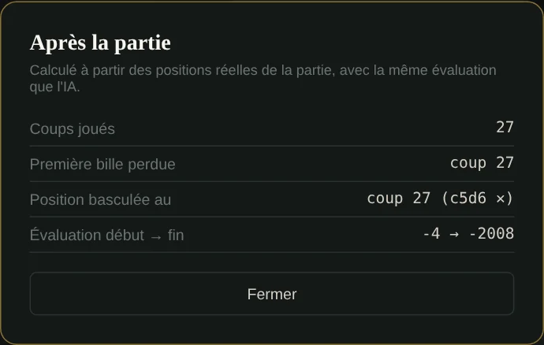
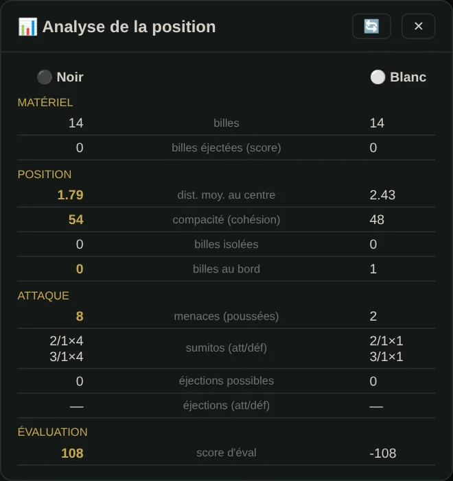
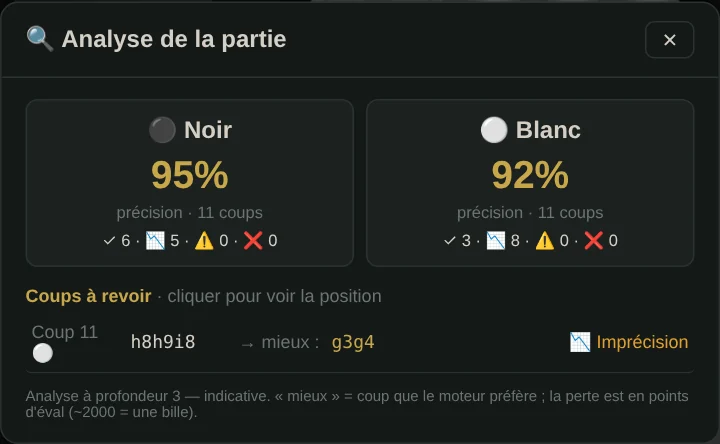
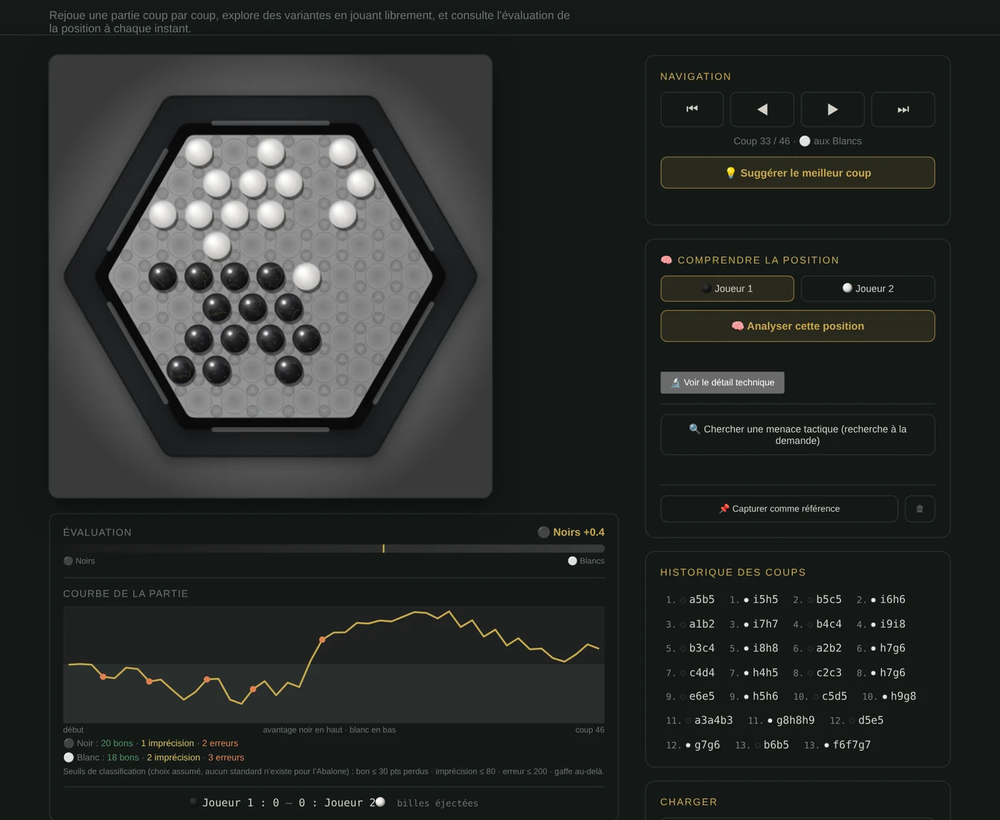
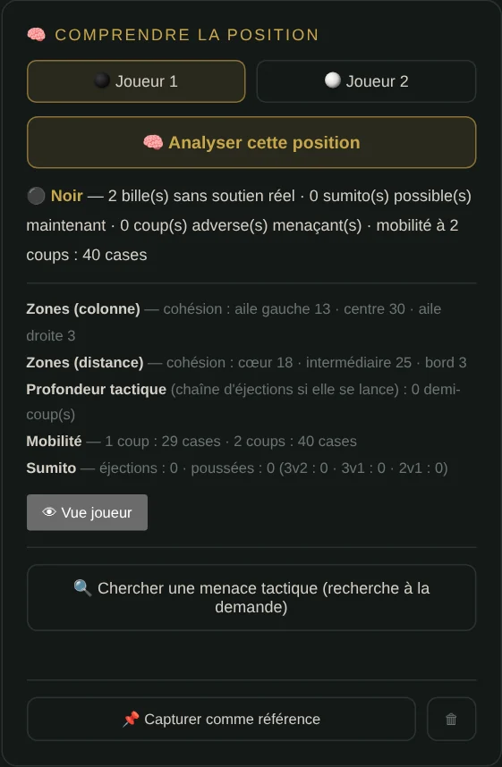

🇫🇷 [Version française](../docs-fr/Analyse.fr.md)

# Analysing a game

Four tools, from the quickest to the most complete. The screenshots come from the real site, on a real game played against the AI (French interface).

| Tool | Where | What it answers |
|---|---|---|
| [After the game](#after-the-game) | Game → **Post-game analysis** | Where did the game turn? |
| [Position analysis](#position-analysis) | Game → **📊 Position analysis** | Who is better here, and why? |
| [Analyse the game](#analyse-the-game-move-by-move) | Game → **🔍 Analyze the game** | Which moves were mistakes, and what should have been played? |
| [Analysis page](#the-analysis-page) | Menu → **Analysis** | Replay, explore, understand a position |

To follow **the AI's own thinking**, see [AI Observatory](Observatoire-IA.en.md) (while it searches) and [AI reflection](Reflexion-IA.en.md) (the table after the move).

## After the game

The shortest summary. It replays the positions **actually reached** during the game with the same evaluation as the AI, from the human player's side, and gives:

- the number of moves played;
- the move where **the first marble was lost**;
- the move where **the game turned**: the largest drop in evaluation between two consecutive positions;
- the evaluation at the start and at the end.

No search is run: it is instant.

## Position analysis

On the position on the board, both sides face to face: **material** (marbles, marbles ejected), **position** (average distance to the centre, compactness, isolated marbles, marbles on the edge), **attack** (possible pushes, sumitos by type, possible ejections) and the **evaluation score**. The better value of each line is in gold. The 🔄 button recomputes it after a move.

## Analyse the game, move by move

For **every move of the game**, the engine searches at **depth 3** from the position before, scores every possible move and compares the move played with the best one. The **loss** is the gap between the two, in evaluation points (an ejection is worth 2000 points). The report gives:

- **each side's accuracy**: 100 × e^(−average loss / 500), and the count of moves per category;
- **the moves to review** (loss above 120 points, the 10 costliest): the move played, the one the engine prefers, and the category. **A click** replays the position on the board.

| Category | Loss |
|---|---|
| ✓ Best | 0 |
| Accurate | up to 30 |
| Correct | up to 120 |
| 📉 Inaccuracy | up to 600 |
| ⚠️ Mistake | up to 1,800 |
| ❌ Blunder | above |

At depth 3 the verdict is **indicative**, and the report says so. On a long game the analysis takes a while: one search per move played.

## The analysis page

**Load**: your last game, the editor's position or the starting position. Then:

- **Navigation** move by move (⏮ ◀ ▶ ⏭). On the board you can **play freely** to explore a line.
- **Evaluation** of the position at every moment, and the **game curve**: Black's advantage up, White's down. A vertical drop marks a mistake; the coloured dots classify the moves (good, inaccuracy, mistake, blunder) and a click jumps to that move.
- **💡 Suggest the best move** for the position shown.
- **🧠 Understand the position**, for either side: marbles without real support, possible sumitos, threatening opponent moves, mobility over 2 moves.
- **🔍 Look for a tactical threat**: a targeted search, only on request.
- **📌 Capture as reference**: the position's fingerprint (12 dimensions, the same for a position and its left-right mirror), to compare with every position visited afterwards.
- **🔬 Show technical detail**: the raw numbers behind each summary.

### Two classifications, two measures

The analysis page curve and the "Analyse the game" report do not measure the same thing:

- **the curve** looks at how much **the position's evaluation** drops from one move to the next, without search; thresholds: good up to 30, inaccuracy up to 80, mistake up to 200, blunder above;
- **the report** compares the move played **with the best move found by a search** at depth 3; thresholds in the table above.

The same move can therefore be classified differently by the two. Both scales are deliberate choices: there is no standard for Abalone.
