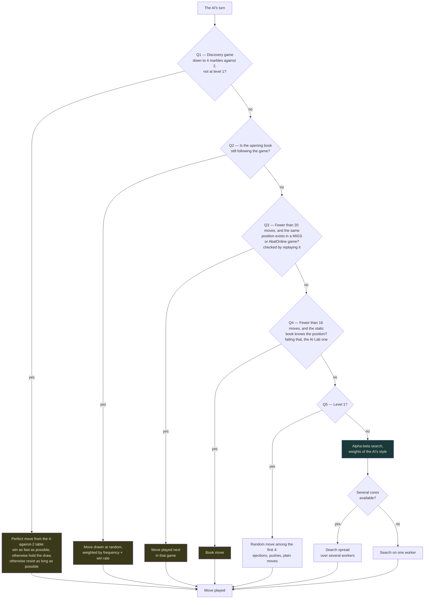
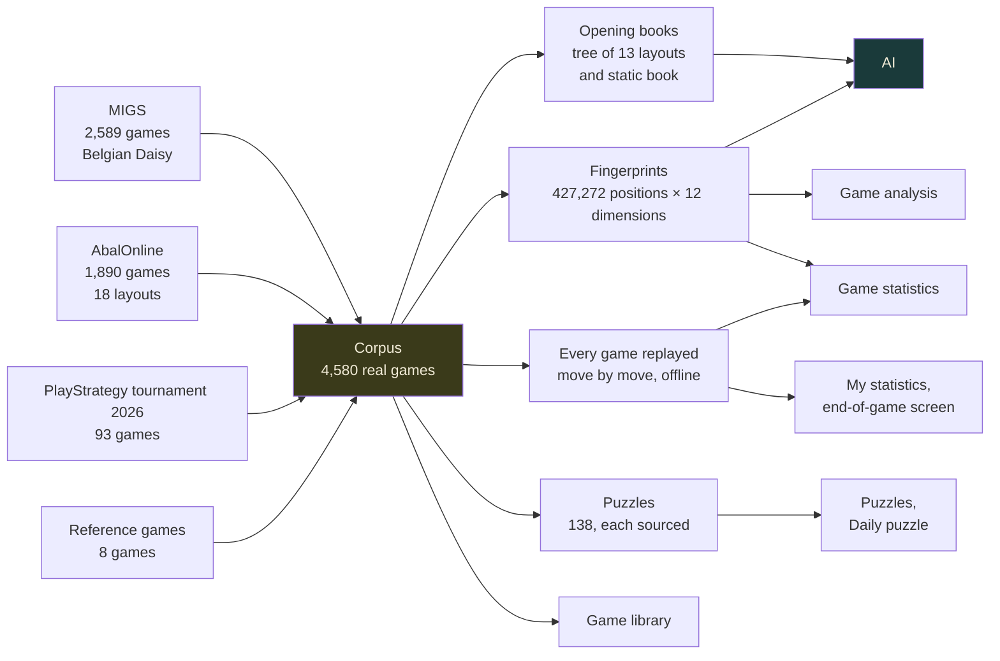
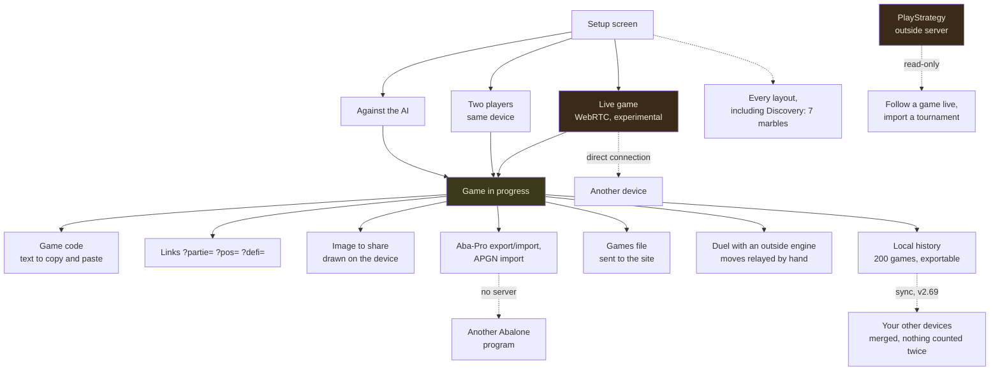

🇫🇷 [Version française](../docs-fr/Architecture.fr.md)

# Architecture — the diagrams

Four maps for understanding how Abalassembly is built. They are **written by hand** and need to be updated when the architecture changes — unlike the site's own "AI briefing" page, which computes everything at runtime. The site's Architecture page gives the short version, in French and in English.

Checked against the code in v2.66. The figures on the site page are gathered in `ARCHI_CHIFFRES` (`src/main/34-architecture-diagrams-briefing.js`), and a test compares them with the embedded data: one more game or puzzle, and the test asks for the update.

---

## 1. How the AI picks its move

The questions are asked in order (`aiMove()`): as soon as an answer is yes, the AI plays the move found; otherwise it moves on to the next one.

**Worth noting:**

- **Question 1** only exists since v2.49: in Discovery mode (7 marbles a side), as soon as a game reaches 4 marbles against 2, the AI no longer computes, it reads the endgame table (see below). At level 1 it does not look it up. If a piece of the table is missing, it is loaded and the AI moves again; if loading fails (no network), the usual AI takes over.
- **Never a move that goes backwards** (v2.60): for questions 2, 3 and 4, a move that brings back a position already seen, or undoes the same side's previous move, is never chosen; at level 1, only when there is no other choice among the 4.
- **The real-games fallback** (question 3), between the two books, is easy to forget: it only kicks in during the first twenty moves, when the main book has lost track of the game but the **same** position (reached in a different order) exists in a MIGS or AbalOnline game. The fingerprints are only used to find candidates: each one is checked by replaying its game. Until v2.59 this fallback took the *closest* historical position, with no threshold: it played moves from other games, often from another layout, and went back and forth (h9g8 then g8h9).
- **Level 1** does not draw among the 4 *best* moves: it sorts the list by kind (ejections first, then pushes, then plain moves) and draws among the first 4.
- **The style**: the search uses the weights of the style chosen for the AI or, in adaptive mode, the one deduced from how you play (you expose your marbles: the AI divides; you attack hard: it gets solid; you play passively: it presses).

---

## 2. Where the data comes from

Everything starts from the real games embedded in the file.

**Details:**

- The **opening books** and the AI's fallback (question 3) only read the MIGS and AbalOnline games (418,595 positions). The 8,677 positions of the PlayStrategy and reference games are added for the 12 dimensions of Game statistics (v2.59), hence 427,272.
- **Every game replayed**: `tools/stats-parties.js` replays offline, with the real engine, the 4,580 games (ejections, kinds of moves, chances, the 12 dimensions of both sides at moves 20, 40 and 60); the result is embedded compressed. It feeds the Game statistics page (falling marbles, what wins games, how real players play — v2.63 to v2.65), the comparisons in My statistics and the line on the end-of-game screen. A test replays a sample and compares.

The corpus is not only a library to browse: it directly feeds the AI's play, the analysis and the statistics.

---

## 3. Game modes and exchanges

The site has no game server. The game code, the links, the image, the exports and the history file work even with no network: all it takes is passing on a text, an address, an image or a file. The `?partie=` link encodes the same code as "Game by code", just carried by the address; `?pos=` carries a position, `?defi=` a daily puzzle.

**Three things to know:**

- **The live game** connects the two browsers directly (WebRTC). The connection codes are exchanged by hand; a public server (STUN) only helps the two devices find each other.
- **Sync my devices** (v2.69): the same direct connection as the live game, or a file. Both devices merge their game data (history, progress, puzzles, heat maps…): games are added without duplicates, a deletion spreads, and each counter keeps every device's share (a "G-counter") so nothing is counted twice. Settings, the Lab and the game in progress stay on each device.
- **PlayStrategy** (v2.48): follow a game live, see the tournaments, import one. The site queries PlayStrategy's server read-only; it sends nothing but a username or a link.

---

## 4. The endgame tables

A normal game (14 marbles a side) never reaches these endgames: it stops as soon as one side has lost 6 marbles. They serve **Discovery mode**, played with 7 marbles, where a side loses when it is down to 1 marble.

| Table | What it says | Where it is used |
|---|---|---|
| 2 against 2, 3 against 2 | **99.9% draws** (2v2: 99.90%; 3v2: 99.85%) | Discovery, Endgame tables page, "Proven endgame" trainer (win proven by retrograde induction, not estimated) |
| 4 against 2 (v2.49) | **Solved and proven**: 140,575,680 positions, each re-checked. With the move, the strong side always wins, in 97 plies at most | **The AI in Discovery** (question 1), verdict "Black wins in N plies", Endgame tables page, Trainer |
| 3 against 3 | Computed and validated: 2 winning positions out of 224 million | Not put online |
| 4 against 3 and beyond | ~2.5 billion positions after symmetry | Out of reach for a single-file site |

The 4-against-2 table is not in the file: it is split into 689 pieces (`tablebase/4v2/`, 45 MB in all), loaded from the site when a game gets there, each checked against its SHA-256 fingerprint. Details: `tablebase/RESULTS.md` and [Distributed computing](Calcul-distribue.en.md).

---

## What these diagrams don't show

- The evaluation's internals (eight weights tuned by SPSA) — see [Experimental engine](Moteur-experimental.en.md)
- Why NNUE isn't enabled by default — see the 0/53 measurement on that same page
- The multi-worker limitations — see [Multi-worker engine](Moteur-multi-worker.en.md)
- How the fingerprints are computed — see [Historical fingerprints](Empreintes-historiques.en.md)
