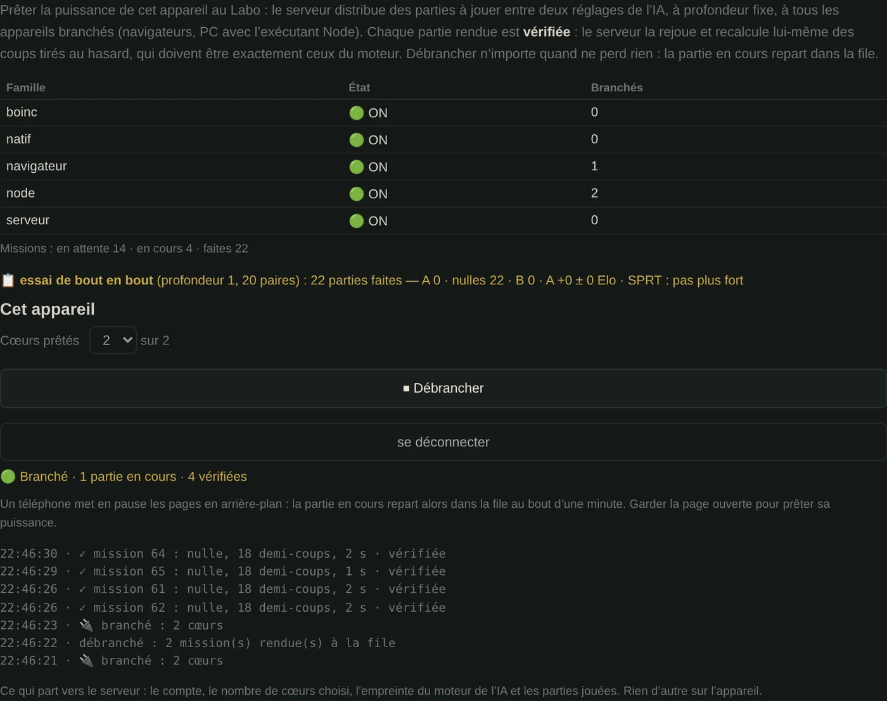

🇫🇷 [Version française](../docs-fr/Calcul-distribue.fr.md)

# Distributed computing

*Since v3.18*, Abalassembly has a **compute network**: a scheduler on the server and executors you plug in and out (browsers, PCs). It is built and tested, but **not open yet**: the server isn't hosted. Further down, the study from before v3.18, which concluded it shouldn't be done, still holds on most points. Here is what changed.

## Since v3.18: the scheduler

**A real computing need has appeared.** Settling two AI settings takes hundreds of games. In November 2026, the duels of the recomputed Texel weights against the game's own took about 2 h 30 for 40 pairs, on 2 cores. These are independent games: exactly what spreads well. At equal speed, ten 4-core browsers would do that work in under 10 minutes.

**The verification problem is solved without computing everything twice.** A Lab game at fixed depth can now be redone move for move, on any device:
- the engine's hash keys come from a fixed seed;
- the board is put back in cell order before each search. Before, the order of the marbles in memory changed from one search to the next, and with it the choice between two moves with the same score.

Checked on 116 plies recomputed one by one in a fresh worker, up to depth 3, without a single difference. So the server replays every game handed in and searches three randomly drawn plies itself, which the executor doesn't know in advance: a move that isn't the engine's, and the game is refused.

**How it works**
- **The Lab creates a campaign**: two weight sets, a depth, a number of pairs. Each pair plays the same opening, colours swapped.
- **Each game is a mission.** The server gives it to a plugged-in executor, with a one-minute lease renewed as long as it sends a heartbeat.
- **Unplugging at any time loses nothing**: the mission goes back to the queue.
- **The switches**: a whole family (all browsers, all Node PCs) or a single executor, for the administrator; "Plug in / Unplug" for each player.
- **The choice takes each device's measured speed into account**: a game too long for a phone goes to a PC.



The network's overall blueprint is in the [site blueprints](Plans.en.md#2-the-compute-network).

*Captured with a test server on the same machine, since the live page can't connect to one yet.*

**In the game**, it's the Lab's **🌐 Compute network** tab: sign in, choose how many cores to lend, plug in. As long as the server isn't online, the tab says so and **nothing leaves** the device. What leaves, once plugged in: the account, the number of cores, the engine's fingerprint and the games played. On a PC, the Node executor in the `abalassembly-api` repository does the same from the command line.

**What stays closed**, with the same rigour as before:
- endgame tables beyond 3v3 (see below);
- training a neural network;
- splitting a live search across several machines (too many dependencies between branches, too much latency);
- graphics cards (CUDA, WebGPU): alpha-beta doesn't benefit from them.

## Since v3.24: self-play, the basis of a "shadow" neural network

A campaign can also be of the **self-play** type (Lab → 🌐 Network, administration): a single AI setting plays against itself, each game from its own randomly drawn 8-ply opening. There is no winner to pick between two settings; the goal is to produce many varied games, verified by the server like all others.

The server turns them into a **position database** (`scripts/exporter-positions.js` in the `abalassembly-api` repository): every position of every game, with the side to move, the marbles pushed out, the current judge's score and the final result from the side to move's point of view (won, drawn, lost). Positions from the random opening are marked, so they can be left out.

This database will train a small neural network that will **not** replace the current judge: it will run alongside, "in the shadow", on the same positions, and the two will be compared (scores, chosen moves, which one best predicts the end of the game, biggest disagreements). The engine that plays stays today's, and verification by recomputation still holds, since the network decides no move.

## The study from before v3.18

Four separate "volunteer computing grid" proposals (BOINC- or World Community Grid-style) had been studied. None had been adopted, and its reasons still hold for what they targeted: endgame tables and training a neural network. The blocker was this: **no calculation existed that would justify the infrastructure.** The Lab's duels, which are one, became the subject of v3.18.

## The real sizes of the endgame tables

This is the mistake common to all four proposals: each one massively underestimated the size of the endgame tables, and each one built its main argument on that estimate. Here are the computed figures, for a 61-cell board:

| Class | Positions | Minimum storage (2 bits/position) |
|---|---|---|
| 2v2 — **already computed** | 3,131,130 | ~1 MB |
| 3v2 — **already computed** | 59,491,470 | ~15 MB |
| 3v3 | 1,110,507,440 | **278 MB** |
| 4v3 | 15,269,477,300 | **3.8 GB** |
| 4v4 | 206,137,943,550 | **51.5 GB** |

For reference, the whole site weighs about 7.8 MB, everything included. Even the 3v3 class, the most modest of the three remaining ones, would outweigh the file by a factor of thirty-five.

The gaps between these figures and the ones claimed in the proposals ranged from a factor of 6 to a factor of 20,000. That gap is consistently what made each proposal collapse once recalculated.

### Two ways to count, both correct

The table above counts **raw** placements — how many marble configurations exist on the board, ignoring the board's symmetries. That's the right measure for showing the scale of the problem.

But 2v2 and 3v2, once **actually computed**, don't occupy that raw space: they exploit the board's 12 symmetries (rotations and reflections) to reduce the weaker side to its canonical positions only, plus a ×2 factor for whose turn it is. Concretely:

| Class | Raw space (table above) | Reduced space (real, validated method) |
|---|---|---|
| 2v2 | 3,131,130 | 6,262,260 *(includes the ×2 for turn, absent from the raw count)* |
| 3v2 | 59,491,470 | 11,703,240 |
| 3v3 | 1,110,507,440 | **224,721,560** |

The reduced method is the one that actually produced the 2v2 and 3v2 tables already embedded in the game — re-checked by rerunning it from scratch in a separate sandbox and comparing the result against the real data, position by position, with zero discrepancy across the tens of thousands of non-empty entries in both tables.

**3v3 has been computed with this same method**, a first: 224,721,560 positions resolved, of which only 2 wins and no forced losses — the rest, draws. A surprising but consistent result: a capture from 3v3 lands on a 3v2 position that's almost always a draw (99.85% of the corpus), so very few captures happen to land on one of the rare decisive positions. Both winning positions were independently re-verified with the real game engine, not just with the calculation that produced them.

**One assumption behind the shipped 3v2 table, verified for the first time rather than just inherited**: the original algorithm never checks whether the stronger side (3 marbles) can lose — it assumes that's impossible without proving it. An isolated black marble genuinely can be pushed by the two white marbles (confirmed with the real engine, on a hand-built position), but a simple push doesn't reduce the marble count. The real question — can white force a full ejection against optimal defense — was tested on a sample of 158,043 black-to-move positions, covering all 180 orbits of the weaker side: zero cases where all of black's moves led to a confirmed white win. The shipped table holds, now on evidence.

**What this doesn't change**: 4v3 remains out of reach for single-file storage even reduced by symmetry (roughly 812 MB estimated, versus 3.8 GB raw) — still tens of times the size of the entire site. A real additional obstacle, found while digging further: half of the retrograde computation (the weaker side, when it's their turn to move) changes its table slot on **every single move, without exception** — splitting the work into independent chunks doesn't work, the whole table would need to stay in memory (or virtual memory backed by a swap file) for the entire computation.

**Where this actually stands**: 3v2 (shipped), 3v3 (computed, validated, not shipped — 2 exploitable positions out of 224 million) and **4v2 (solved in September 2026: with the move, the stronger side always wins, in at most 97 plies)**. 4v2 only depended on 3v2; it took about 20 minutes in C on a single core (see `tablebase/RESULTS.md`). 4v3 depends on 3v3 and 4v2, and remains out of the site's reach: about 2.5 billion positions after symmetry.

## The four computing candidates, and why none holds up

**3v3 endgame tables and beyond** — incompatible with the single-file architecture, see the table above. The project stopped at 3v2 for this reason, and that was the right call.

**Training a neural network (NNUE)** — the candidate that came up most often, usually presented as the priority. It's ruled out based on measurement, not intuition: the network is **blind to tactical positions**, and this isn't a data-volume or compute-power problem. See [Experimental engine](Moteur-experimental.en.md), section "Why no NNUE — the 0/53 measurement". Throwing more compute at a model that systematically misses ejections wouldn't fix it.

**SPSA weight optimization** — the Lab already does this, locally, on a few workers. It doesn't need outside help.

**Position generation and game analysis** — the corpus of 4,479 real games is already embedded and put to use (opening books, historical fingerprints, statistics). There's nothing left waiting to be computed.

## Two architectural constraints, verified in the code

**Workers are created from an embedded string**, never from a separate file:

```js
const blob = new Blob([AI_WORKER_CODE], { type: 'application/javascript' });
_aiWorker = new Worker(URL.createObjectURL(blob));
```

Several proposals suggested a standalone `distributed-worker.js`. A separate file **breaks operation over `file://`** — meaning from a USB drive, offline, which is the project's founding principle.

**`SharedArrayBuffer` is unusable here.** It requires the COOP/COEP HTTP headers, which can't be set on GitHub Pages. This is the same limitation that already prevents a transposition table shared across workers (see [Multi-worker engine](Moteur-multi-worker.en.md)).

## The verification problem

*(Solved by v3.18: reproducible games, the server recomputing randomly drawn plies, see above.)*

Without a server, there's no way to verify that a contributor actually computed what they're sending back. A malicious — or simply buggy — client could return anything at all.

Real grids (BOINC, World Community Grid) solve this by distributing the same task to several machines and comparing the results. That requires exactly the central server the offline architecture is trying to avoid, and doubles the compute cost.

Manually merging files received by email isn't a computing grid: it's file-sharing, with no guarantee about their contents.

## What's still worth keeping from these proposals

Three points are worth keeping for whenever this question reopens:

**Strict consent.** Nothing on by default, an explicit checkbox, an adjustable power limit, an immediate stop button, and clear wording on what's being computed. A site that ran computation without explicit agreement would rightly be treated as a hidden cryptominer.

**Redundant validation.** The same task distributed to several machines, a result accepted only if the answers agree; plus control tasks whose answer is already known.

**Start with a reproducibility test, not the endgame tables.** Have several browsers compute random positions and check they land on exactly the same result. This tests the whole chain — distribution, computation, validation — without committing weeks of compute to an uncertain goal. This was the best advice across all four documents.

## Under what conditions this reopened

*(The first is met by the Lab's duels; the second remains: hosting the server.)*

Two, both required:

1. **A real computing goal** — something whose result would actually fit in the site and bring a measurable improvement. None of the four current candidates meets this bar.
2. **An active backend** — `abalassembly-api` exists but stays deliberately dormant. It's the precondition for aggregation and verification, and would unlock a genuine Elo leaderboard along the way.

Until then, building "lend my CPU" toggles would mean promising contributors a computation nobody actually needs.
