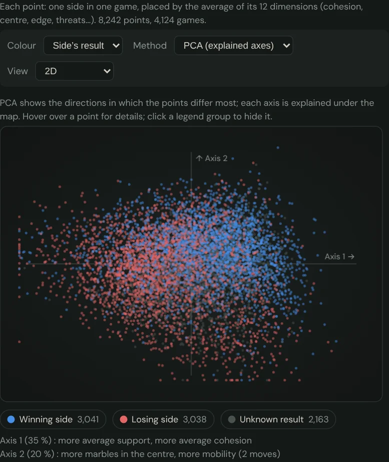

🇫🇷 [Version française](../docs-fr/Cartes-des-donnees.fr.md)

# Data maps

Since v3.27, four pages draw their figures as a map: a coloured cloud of points, in 2D or rotating 3D. Each point is a game, a Lab setting or a position. Two nearby points are similar according to the game's 12 dimensions: cohesion, support, centre, edge, threats, mobility, and so on (see [Historical fingerprints](Empreintes-historiques.en.md)).

## The four maps

| Page | One point is… | Colours to choose from | Clicking a point |
| --- | --- | --- | --- |
| Game statistics | one side in one corpus game (average of its positions) | side's result, source, side, length, players | replays the game |
| My statistics | one of your games, among real players' games (in grey) | your result, AI level, your colour, when | replays your game |
| Lab, dashboard | a setting of the 16 weights: champions, adopted, rejected, undecided, screened-out mutants, SPSA path, mutants being tested | verdict | — |
| Analysis | a position of the loaded game, among 4,000 real players' positions; one line per side, numbered by ply | side | goes to that ply |

The Game statistics map follows the page's filters (source, layout, length, period, players). The My statistics map measures your games only once, on request ("Draw my map" button). The result is kept on your device. The Analysis map is drawn on request, for the loaded game.

## Two ways to bring 12 dimensions onto the screen

- **PCA** (principal component analysis): instant. It shows the directions in which the points differ most, and each axis is explained under the map, for example "Axis 1 (35%): more average support, more average cohesion". Your games and the analysed game are placed on the real players' map without moving it.
- **t-SNE**: brings similar points together, so the clusters are families of games. Its axes have no meaning, nor do distances between far-apart clusters. It is computed in a separate thread, on at most 1,200 points (about 10 seconds on a PC), and the same input always gives the same map.

## Reading and handling the map

- **In 3D:** rotate the map with the mouse, a finger or the arrow keys. The + and − keys zoom, and ⟲ resets the view.
- **A point's details:** hover over it.
- **Hiding a group:** click it in the legend.
- **Extreme points:** 99.5% of the points fit in the frame; the few others are placed on its edge.
- **Your settings** (method, view, colour) are remembered on your device.

## What the map does not say

A map summarises: 12 numbers become 2 or 3. Two nearby points have similar averages, not necessarily similar games move by move. The Lab map only records decided mutants since v3.27; before that, only the champions and the SPSA path were kept.
