🇫🇷 [Version française](../docs-fr/Observatoire-IA.fr.md)

# AI Observatory

*Since v3.05, extended up to v3.17.* A panel that shows what the AI computes **while** the game goes on, then why it picked its move. The screenshots below come from the real site, during a real game against the AI (French interface).

**To open it**: in a game against the AI, the **"🔭 AI Observatory"** tab of the right-hand column (or the button of the same name in the Game tab). *Since v3.15*, it is no longer a window: the Observatory is a tab of the right-hand column, like List or Comments. It has five tabs and three levels of detail: **Spectator**, **Analyst**, **Developer**.

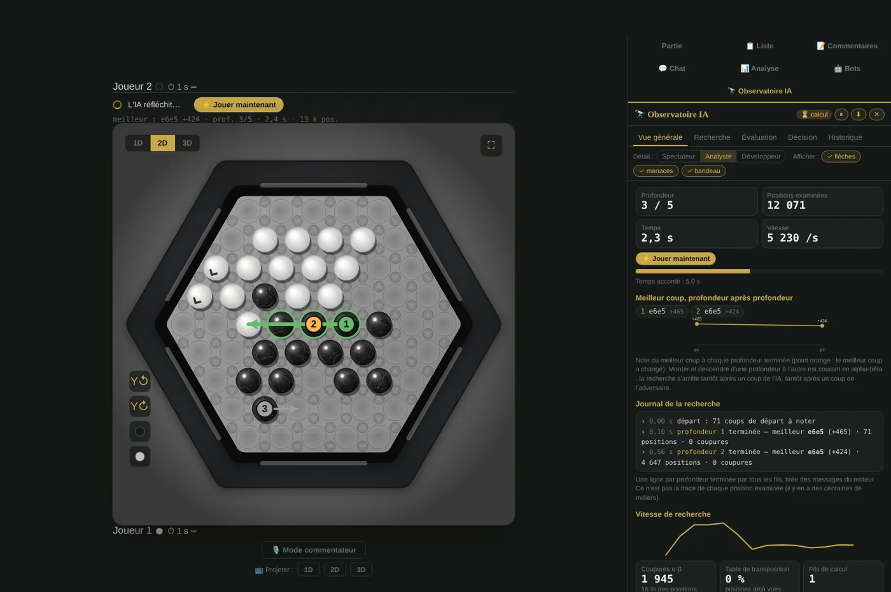

On a computer, it sits next to the board, and the column widens while it is open on screens of at least 1,700 px. On a phone, it is under the board, like the other tabs. Switching to another tab closes it, and the arrows on the board only show while it is open; the site remembers the open tab.

> The engine's choices are unchanged: it only sends its measures while searching (at most every 150 ms). A test checks that it plays the same move, with the same positions searched, whether the panel is open or not. Nothing leaves the browser.

## The game board, live

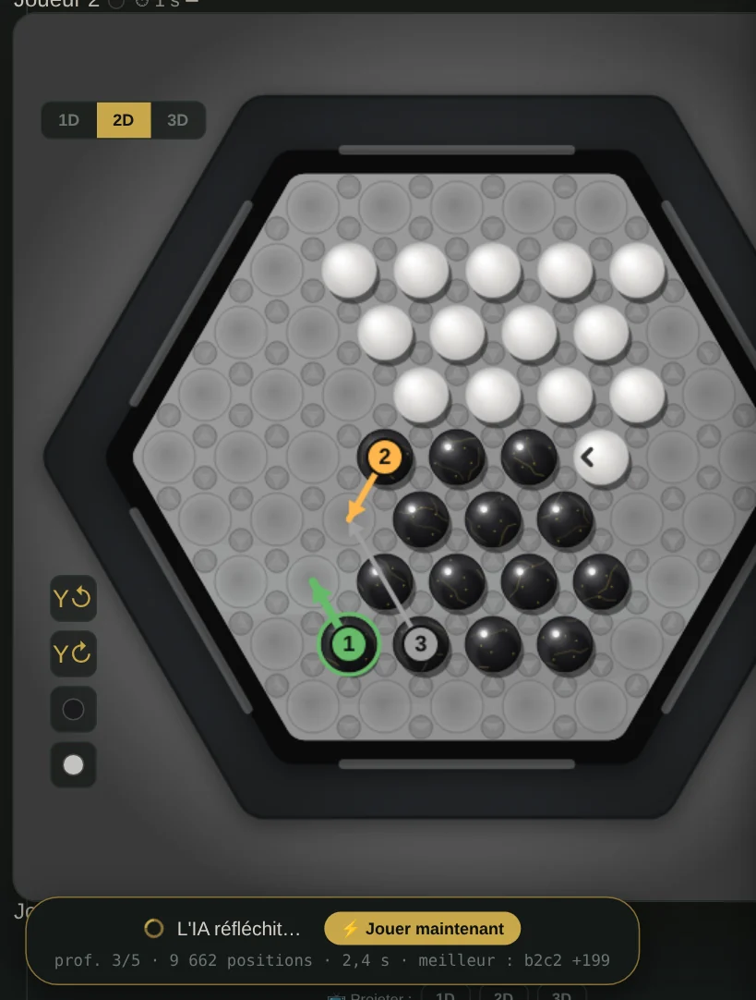

- **The 3 best moves of the moment**, as arrows numbered like the list: **1** green, **2** orange, **3** grey. An arrow starts at the last marble of the group and ends on the cell where the first one lands; the best move's marbles are circled.
- **Marbles at risk** on both sides: red for a marble on the edge with one ally or fewer, orange for an isolated marble. These are the engine's evaluation definitions.
- **"AI is thinking…"**, in the bar of the player the AI plays (player 2, usually), with the **⚡ Play now** button and a line of measures: provisional best move, depth, time, positions searched. *Since v3.14*, this area stays in the bar for the whole game, so the board does not move: while the AI waits for your move, it recalls its last search. It shows even with the panel closed.

All of it is set on the line under the tabs: **Show: arrows, threats, banner**.

## Overview

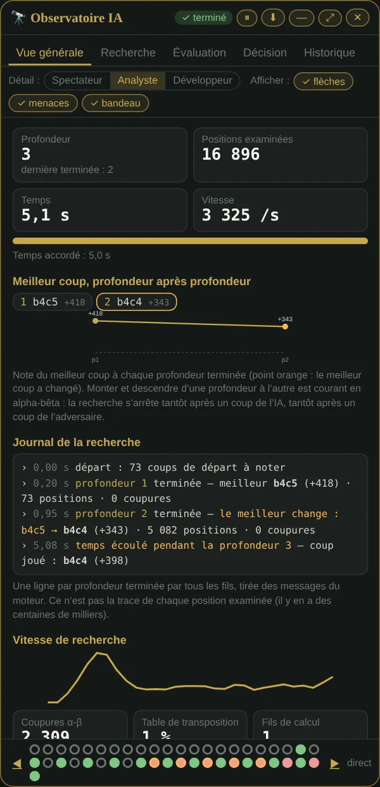

Depth reached, positions searched, time out of the allowed time, speed. Then:

- **the best move, depth after depth**, and the **curve of its score** (orange dot when the best move changes);
- **the search log**: one line per completed depth, with the best move, its score, the positions and cutoffs, and "best changes" when it does; at the end, the move played, and "time ran out during depth N" if the timer cut in;
- speed, alpha-beta cutoffs, transposition table, pruning by depth; at Developer level, thread by thread.

*Since v3.17*, the **search tree** is there too, in simple view (see below); **details →** opens the Search tab.

## Search: the moves studied

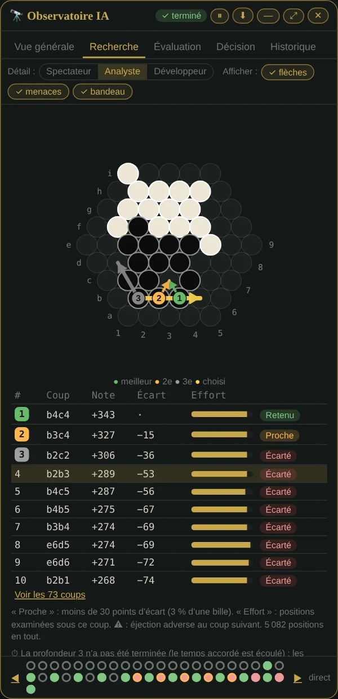

Every first move, with its score, its gap with the best one, the search effort spent under it, and ⚠ when the opponent has an ejection right after. The mini board shows **Aba-Pro coordinates** (letters a to i, numbers 1 to 9) to read the notation.

### The search tree

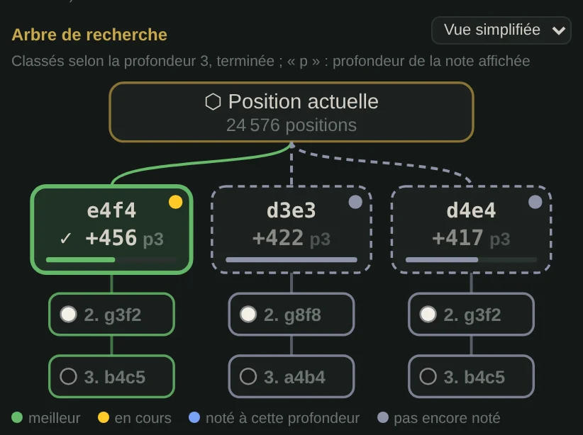

*Since v3.17.* At the top of the tab: the position, its best first moves as scored boxes, and under each one the **line the AI expects** (2. the expected reply, 3. the follow-up…). The black or white dot says who plays.

**During the search, the tree fills up.** Moves are ranked by the last completed depth, so the order doesn't jump around. The dot at the top right of each move says where it stands at the depth being searched:

- **yellow**: a worker thread is searching it right now;
- **blue**: its score at this depth is known, and that is the score shown;
- **grey**, dashed frame: not scored yet, it keeps its previous score.

The small **p3**, **p4** next to the score says which depth it comes from. The bar under the score shows the search effort spent under the move. The green frame marks the best move so far, then the move played.

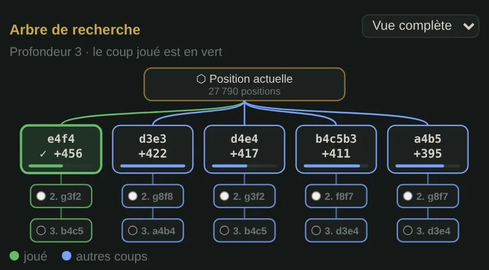

**Simple view**: 3 moves, 2 levels of line. **Full view** (Analyst, Developer): 5 moves and the whole stored line; on a narrow screen it scrolls sideways. The site remembers the chosen view. Tapping a move selects it, as in the list. Once the move is played, tapping a box of the line shows the board at that step.

Two things from the mockups are not there, because they would be invented. First, **several scored replies under a move**: the engine only keeps the reply it expects, and scoring the others would mean searching again. Second, a **"pruned" box**: no first move is pruned, each one is searched in full; pruning happens deeper, and the engine counts cutoffs without recording which ones. At Developer level, the **10 principal lines** are still listed at the bottom of the tab.

### Heat map: where the AI wants to go

*Since v3.12.* The cells in orange are those where the **10 best moves** bring a marble. Each cell takes the best score of the moves that lead there: full colour for the best move, paler and paler down to the 10th. A cell already occupied (a pushed marble) gets a halo. Hovering a cell shows the move and its score. The **🔥** link under the board hides or shows it.

### Preview on hover

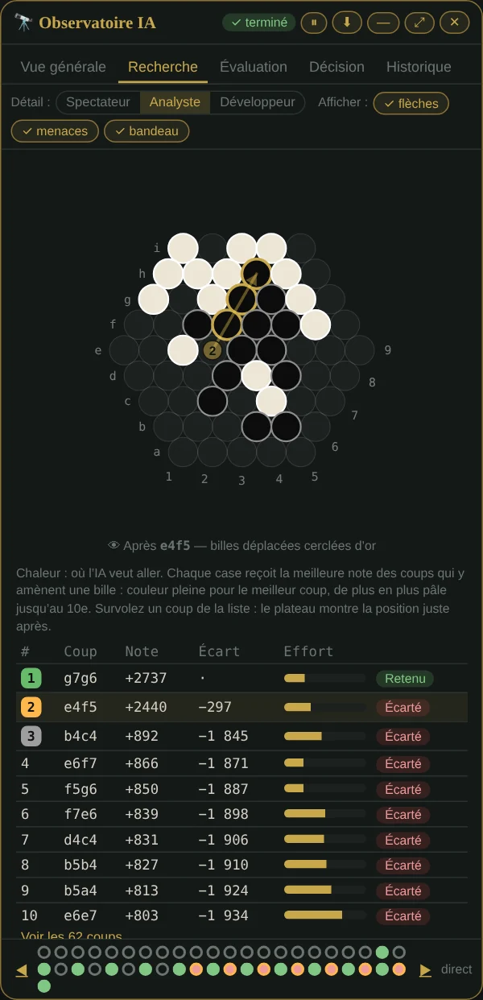

*Since v3.12, with a mouse.* Hovering a move in the list (or a branch of the tree) shows on the mini board **the position right after that move**: the moved marbles are ringed in gold, the pale arrow recalls where they came from. The position is computed with the site's rules, without search. With a finger, tapping a move selects it, as before.

### "Why not this move?"

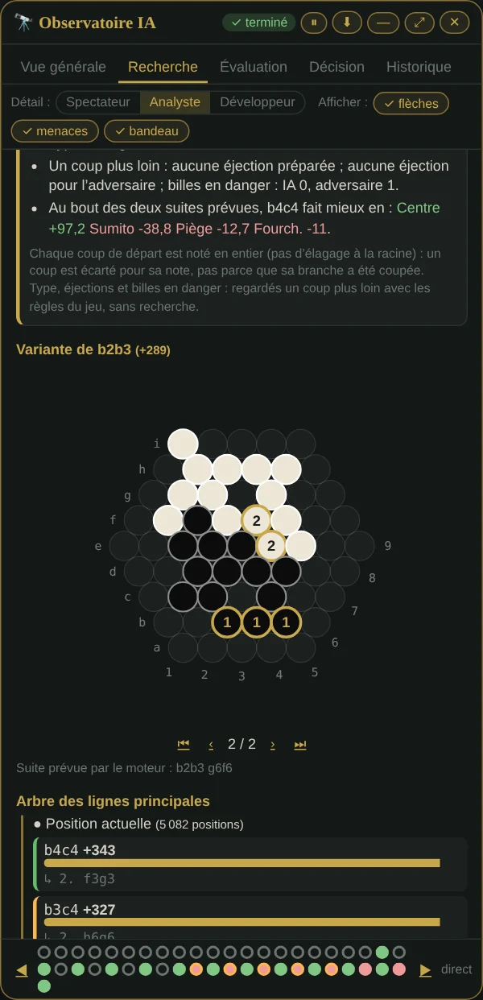

Clicking a move in the list opens its card. It only holds facts:

- its rank and score, its gap with the chosen move, in points and in marbles;
- **its score depth after depth**. If it led earlier and then fell back, the card says so: searching further, the engine found a better reply for the opponent;
- what the rules show **one move ahead**: move type, ejections set up, ejections left to the opponent, marbles in danger;
- the criteria that differ at the end of both expected lines, when they are kept.

Below, the **expected line**, move by move, on a small board.

## Decision: why this move rather than another

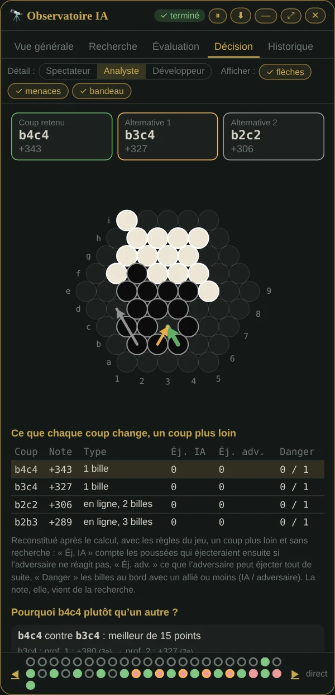

The chosen move and its two best alternatives, as arrows of the same colours, then a table: move type, ejections set up by the AI, ejections available to the opponent, marbles in danger on each side. These columns are **rebuilt after the search with the game rules, one move ahead, without search**: the panel says so. The score itself comes from the search.

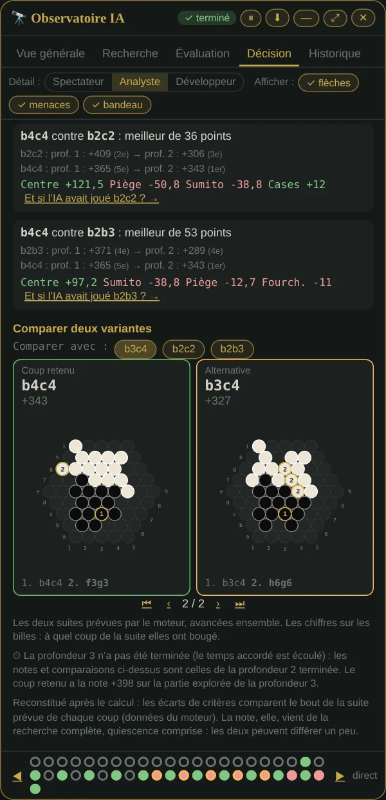

Further down, **two lines side by side**, stepped together. The numbers on the marbles tell at which move of the line they moved.

## Evaluation: what makes up the score

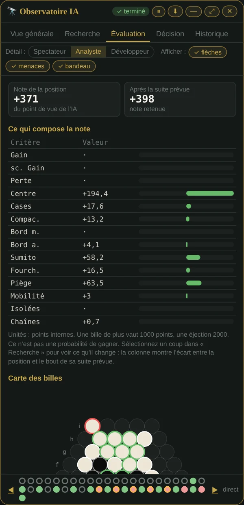

The engine's evaluation criteria, with their values, as bars centred on zero, and what the selected move changes. The score is in **internal points**: one marble ahead is worth 1000, an ejection 2000. It is not a win probability.

### Measured winning chance

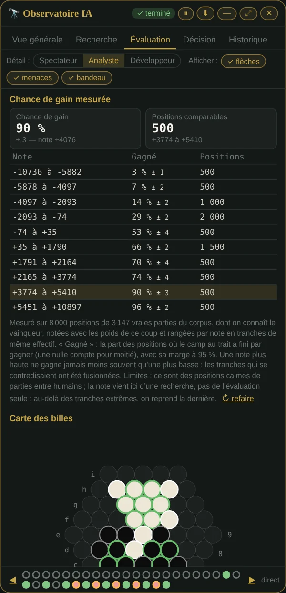

*Since v3.13.* What a score is worth, **measured on real games**: 8,000 positions of the corpus whose winner is known, scored with the observed move's weights and sorted by score into slices of equal size. For each slice, the share of positions where the side to move went on to win (a draw counts as half), with its 95% margin. A higher score never wins less often than a lower one: slices that contradicted each other are merged. The **📏 Measure on real games** button runs the computation (about a second on a computer); the result stays in the browser and also shows in the Overview and the report.

A single curve (the Texel method's, p = 1 / (1 + e^(−s × score))) was tried first: on the control games, one marble ahead was predicted at 68 % and won 95 % of the time. Hence measured slices rather than a model. Limits: these are quiet positions from games between humans, and the Observatory's score comes from a search, not the evaluation alone.

## History and strip

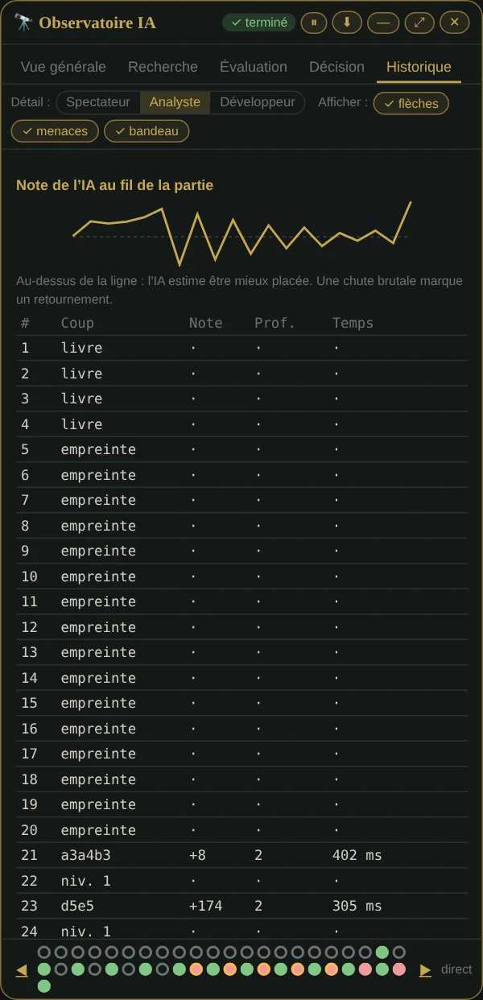

The AI's score over the game, the list of its decisions, and **"Re-run this search deeper"** for a past move. At the bottom of the panel, on every tab, a **strip**: one dot per AI move (red when the score is negative, ringed orange after a drop of 200 points or more, hollow without search), a dot that pulses while searching, ◀ ▶ to step from move to move. **Since v3.12, the review stays put**: when you look back at an earlier move, the AI's next search no longer brings you back to live. The game board keeps showing the running search, and the pulsing dot of the strip (or "Back to live") brings the panel back to it. The game report can be **copied** or **downloaded** (.txt, and .json at Developer level).

## On a phone

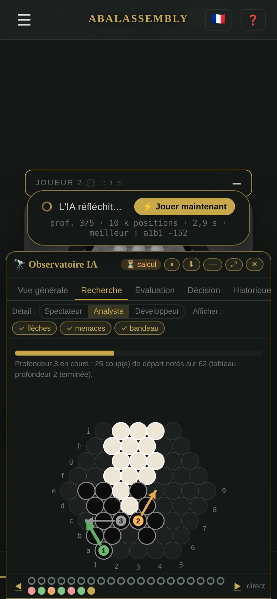

On a phone, the Observatory opens under the board, in the game's tabs: scroll the page to go from one to the other. Meanwhile, "AI is thinking…" stays in player 2's bar, above the board, and the arrows stay on the board. A table too wide for the screen scrolls inside the panel, without widening the page.

*Before v3.15*, the panel was a window: a drawer on a phone, with a **—** button to shrink it to one line and **⤢** for full screen. In the column, these window settings no longer apply.

## What the panel does not claim

- **No full tree**: the engine does not keep the thousands of positions it searched. The drawn tree shows the best first moves and, under each one, a single reply per level: the one the engine expects.
- **No pruning at the root**: every first move is fully scored. A move is set aside for its score, not because its branch was cut.
- **No invented "confidence"**, no "memory used": we show the gap with the 2nd move, how many depths the choice stayed the same and, on request, the winning chance measured on real games: measured facts.

## For the Lab: the levels' real search times

*Since v3.13.* In the Lab, **Levels** tab, a checkbox records, for each move the AI plays against you, the depth completed by all its threads, the time used and the time allowed. The table tells, level by level, how far the AI really goes on **your** device, and the time it would take to complete its planned depth in 8 moves out of 10. Nothing leaves the browser, nothing is changed in the levels.

See also: [AI reflection](Reflexion-IA.en.md) (the table after the move) and [Analysing a game](Analyse.en.md).
