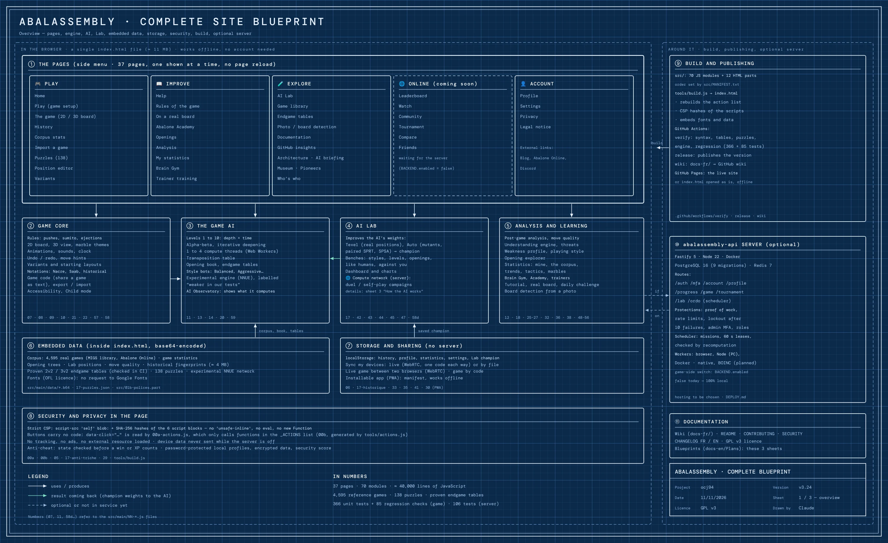
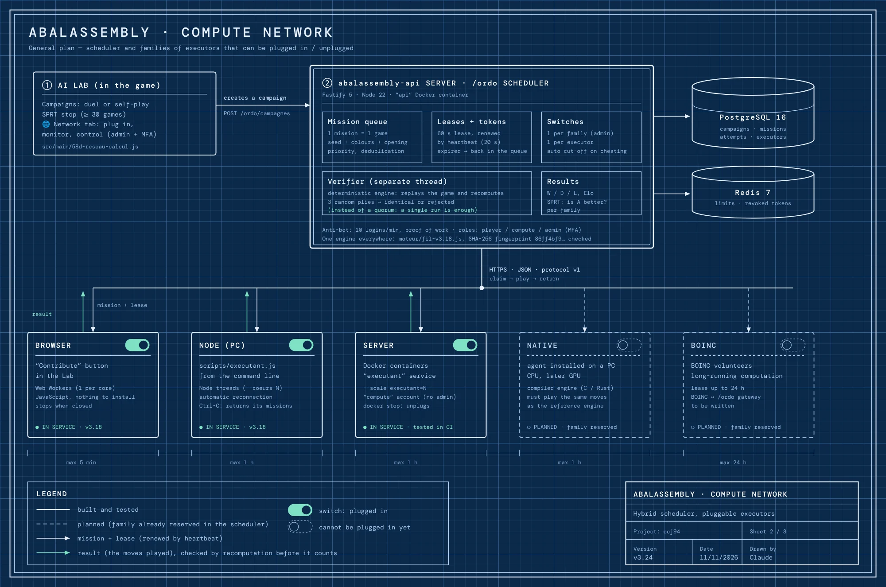
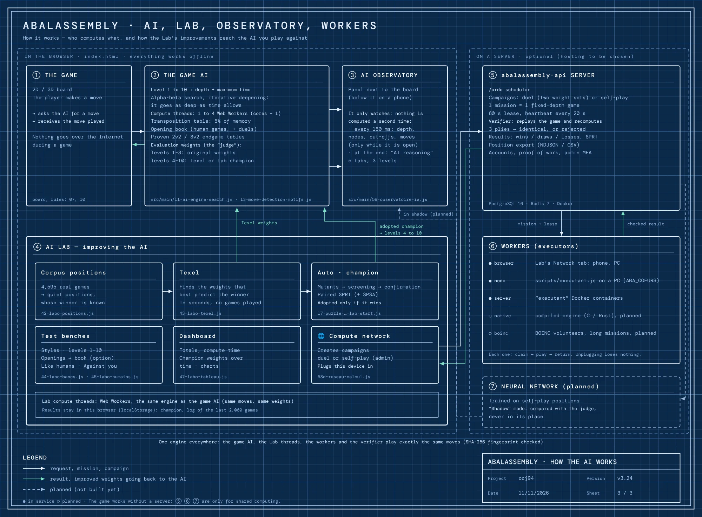

🇫🇷 [Version française](../docs-fr/Plans.fr.md)

# Site blueprints

Three sheets drawn like architect's blueprints, from the overview down to the details. They complement the diagrams on the [Architecture](Architecture.en.md) page: those follow the code step by step, these blueprints show who does what and how the parts talk to each other.

Checked against the code in v3.24. They are **drawn by hand**: update them when the architecture changes (see "Editing a blueprint" at the bottom).

---

## 1. Overview

The whole site on one sheet. On the left, what runs in the browser from the single `index.html` file, with no account and offline: the 37 menu pages, the game core, the AI, the Lab, analysis, embedded data, local storage and the page's protections. On the right, what surrounds it: the build (`tools/build.js`, GitHub Actions, GitHub Pages), the optional server and the documentation.



## 2. The compute network

How the Lab gets campaigns of games played by other devices: the server's `/ordo` scheduler hands out missions, each family of executors (browser, Node, Docker server; native and BOINC planned) plugs in and out, and every returned game is checked by recomputation before it counts. Details: [Distributed computing](Calcul-distribue.en.md).



## 3. How the AI works

Who computes what during a game, and how the Lab's improvements make their way back to the AI: the Texel weights and the adopted champion replace those of levels 4 to 10; the AI Observatory watches the search without recomputing anything; the server and its workers are only for shared computing; the planned neural network will be compared with the "judge" in shadow mode, never put in its place. Details: [AI Observatory](Observatoire-IA.en.md), [AI reasoning](Reflexion-IA.en.md).



---

## Editing a blueprint

The sources are in `tools/plans/`: one HTML page with an SVG drawing per sheet and per language (`vue-ensemble.fr.html`, `vue-ensemble.en.html`…). Fix both languages, then redraw the images:

```
npm i -D playwright          # once; only this script uses it
node tools/plans/rendu.js    # writes docs-img/plan-*.fr.webp and plan-*.en.webp
```
