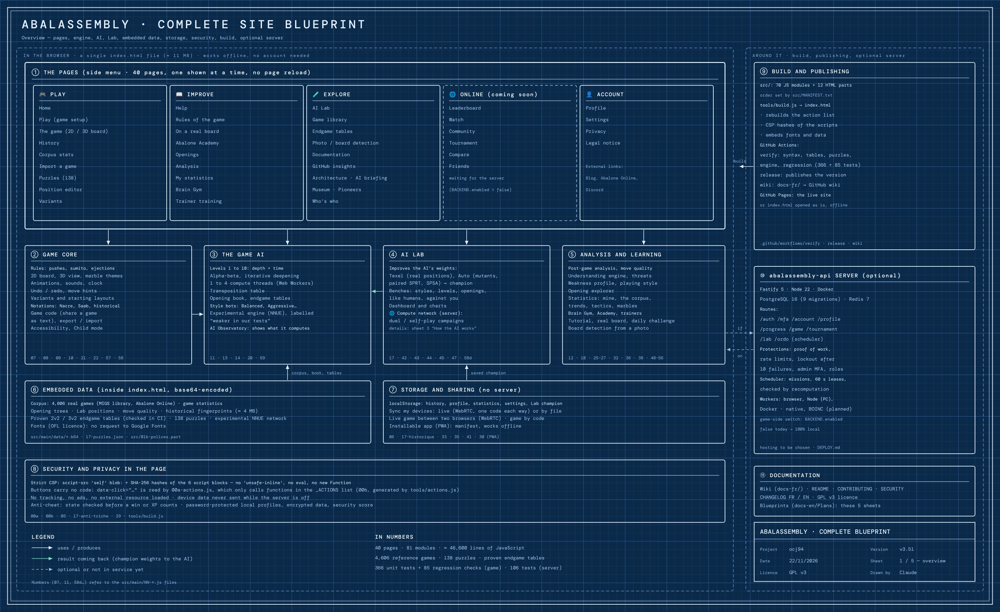
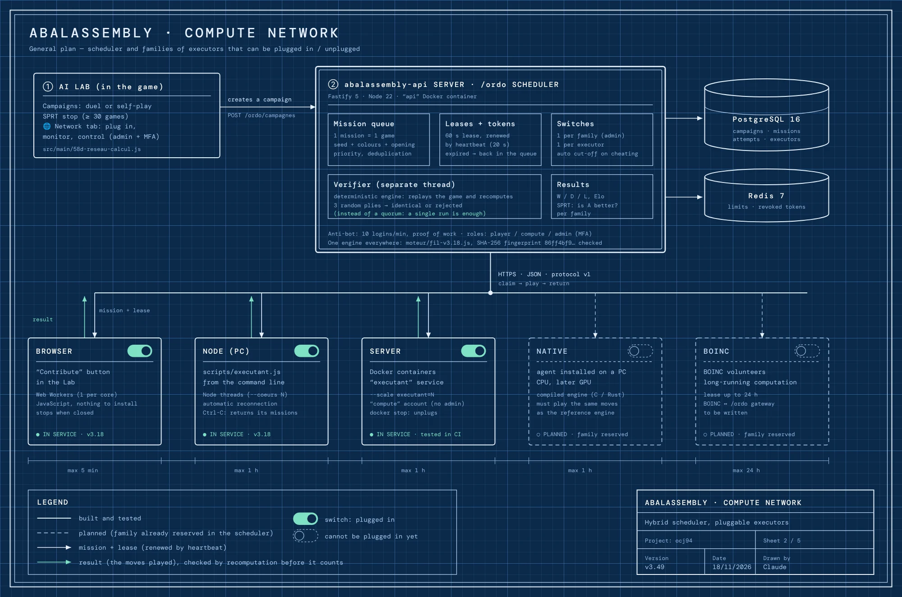
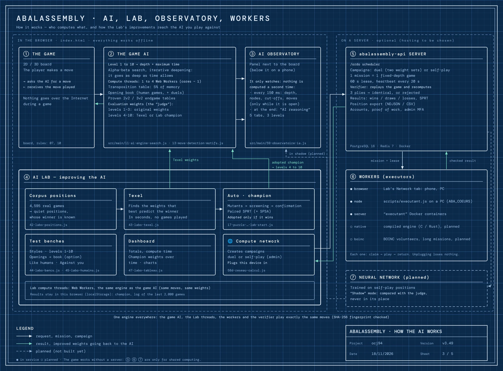

🇫🇷 [Version française](../docs-fr/Plans.fr.md)

# Site blueprints

Three sheets drawn like architect's blueprints, from the overview down to the details. They complement the diagrams on the [Architecture](Architecture.en.md) page: those follow the code step by step, these blueprints show who does what and how the parts talk to each other.

The three sheets were checked against the code in v3.49; the page inventory, at the bottom, is checked by a test on every push.

---

## 1. Overview

The whole site on one sheet. On the left, what runs in the browser from the single `index.html` file, with no account and offline: the menu pages (inventory below), the game core, the AI, the Lab, analysis, embedded data, local storage and the page's protections. On the right, what surrounds it: the build (`tools/build.js`, GitHub Actions, GitHub Pages), the optional server and the documentation.



## 2. The compute network

How the Lab gets campaigns of games played by other devices: the server's `/ordo` scheduler hands out missions, each family of executors (browser, Node, Docker server; native and BOINC planned) plugs in and out, and every returned game is checked by recomputation before it counts. Details: [Distributed computing](Calcul-distribue.en.md).



## 3. How the AI works

Who computes what during a game, and how the Lab's improvements make their way back to the AI: the Texel weights and the adopted champion replace those of levels 4 to 10; the AI Observatory watches the search without recomputing anything; the server and its workers are only for shared computing; the planned neural network will be compared with the "judge" in shadow mode, never put in its place. Details: [AI Observatory](Observatoire-IA.en.md), [AI reasoning](Reflexion-IA.en.md).



---

---

## Page inventory

Every page of the site, by its identifier in `index.html`. **This list is checked by a test** (`v3.49` in `tests/engine.test.js`): a page added to the site without its line here, or a line here without its page, and the verification fails. That is what keeps this document from falling behind — which it did three times.

| Identifier | Page | What it is for |
|---|---|---|
| `page-home` | Home | The way in: play, the daily challenge, the seven lessons. |
| `page-setup` | Play | Choosing the game: layout, opponent, level, style, clock. |
| `page-game` | The board | The game itself, with the AI Observatory and live analysis. |
| `page-campagne` | Campaign | Twenty-four named opponents in four chapters (v3.41). |
| `page-lecons` | Seven lessons | Seven two-minute screens for someone who has never played (v3.46). |
| `page-learn` | Rules | The complete rules, as a reference. |
| `page-academy` | Abalone Academy | The long lessons and strategy. |
| `page-openings` | Openings | The opening tree drawn from real games. |
| `page-plateau` | On a real board | The notebook for playing on your wooden board. |
| `page-formateurs` | Trainers’ course | What is needed to run a session with a group. |
| `page-aide` | Help | What every screen of the site does. |
| `page-puzzles` | Puzzles | Positions to solve, taken from real games. |
| `page-tablebase` | Endgame tables | The endgame trainer, backed by the 4-against-2 table. |
| `page-gym` | Brain Gym | Position-reading exercises. |
| `page-editor` | Editor | Compose a position and hand it to the engine. |
| `page-analysis` | Analysis | Replay a game move by move, with the position map. |
| `page-stats` | My statistics | Your games, including what the AI made of them (v3.38). |
| `page-calendrier` | Calendar | Days as columns, hours as rows: games, Lab, challenges (v3.44). |
| `page-corpusstats` | Game statistics | The human corpus: 4,233 games, and the data maps. |
| `page-historique` | History | Your archived games, filterable and replayable. |
| `page-biblio` | Documentation | The project’s documents, including the wiki’s. |
| `page-camera` | Photo / board detection | Reading a real board through the camera: photo, live, augmented reality. |
| `page-lab` | AI Lab | Training the engine against itself, by pairs and by SPRT. |
| `page-lab-host` | Lab worker | The page that lends this device to distributed computing. |
| `page-archi` | Architecture | The four cards: the AI, the data, the exchanges, the tables. |
| `page-github` | GitHub insights | The repository’s activity, read from published data. |
| `page-variants` | Variants | The 189 starting layouts, with their history. |
| `page-museum` | Museum | Editions of the game and its objects. |
| `page-pioneers` | Pioneers | The people who made Abalone. |
| `page-trombi` | Gallery | The faces of the game. |
| `page-leaderboard` | Leaderboard | The leaderboard, waiting on the server. |
| `page-observe` | Observe | Watch a game in progress. |
| `page-community` | Community | Clubs, federations, links. |
| `page-tournament` | Tournament | The site’s tournaments. |
| `page-compare` | Compare | Put two players or two engines side by side. |
| `page-friends` | Friends | Friends, waiting on the server. |
| `page-profile` | Profile | Your profile, your badges (twenty since v3.45) and your progress. |
| `page-settings` | Settings | Settings, including move announcements (v3.42) and accessibility. |
| `page-mentions` | Legal notice | Publisher, host, licence. |
| `page-privacy` | Privacy | What the site keeps: everything on your device, nothing elsewhere. |

---

## Editing a blueprint

The sources are in `tools/plans/`: one HTML page with an SVG drawing per sheet and per language (`vue-ensemble.fr.html`, `vue-ensemble.en.html`…). Fix both languages, then redraw the images:

```
npm i -D playwright          # once; only this script uses it
node tools/plans/rendu.js    # writes docs-img/plan-*.fr.webp and plan-*.en.webp
```
