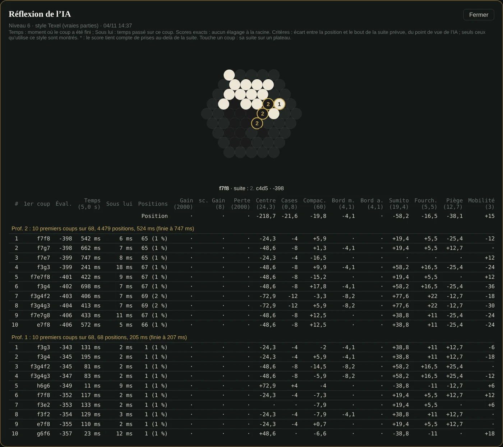

🇫🇷 [Version française](../docs-fr/Reflexion-IA.fr.md)

# AI reflection

*Since v2.49.* After the move, the table that shows **why** the AI played it, modelled on the one in [KAAH](https://saabalone.github.io/KAAH_Test/) (Saab's application), but computed by Abalassembly's engine.

*Screenshot of the real site (French interface): the table opened from an AI move, its first line touched to show the expected line on the small board (each moved marble numbered).*

## Where to see it

- **In the game**: under the move list, the **"▸ AI reflection"** panel shows the table of the AI's last move, updated after each one.
- **For any AI move**: touch its evaluation, under the move in the list ("Mil. +1090 · prof. 8 · 19,0 s ›").
- The table stays in memory during the game. The history keeps each move's compact evaluation (phase, score, depth, time), not the whole table, which is too large.

## What it contains

For **each completed depth** (the deepest first): "Prof. 4: top 10 first moves out of 55, 48,310 positions, 2.1 s (finished at 3.4 s)", then the **10 best first moves**:

| Column | Meaning |
|---|---|
| Éval. | the move's score, from the AI's side ("Gagne" / "Perd" for a forced win or loss) |
| Temps | when this move was finished, since the start of the thinking |
| Sous lui | time spent on this move |
| Positions | positions searched under this move (and their share of the depth) |
| Criteria | each criterion's gap between the position and the **end of the expected line** |
| Expected line | the moves the AI expects; touch the line to see it on a small board, each moved marble numbered |

A **Position** line gives the criteria's values at the start. **Only the criteria used by the game's style** are shown: never a column of zeros that would suggest a criterion counts.

## What guarantees the numbers

- **Exact scores.** Abalassembly searches every first move with a full window: nothing is pruned at the root, so no "≤" as in KAAH.
- **The criteria shown are exactly the engine's evaluation**: `evalDetail` is an exact copy of `evaluateBoard`, and their sum is checked equal on real positions (tests, sections 43-44).
- **Checked lines.** The expected line is rebuilt from the transposition table; since its key does not contain the side to move, each move is checked **legal for the right side**, otherwise the line stops: never an invented line.
- **Asterisk \***: the score accounts for ejections computed *beyond* the line shown (the engine extends as long as a capture remains possible). The table flags it instead of hiding it.
- The positions of the top 10 first moves add up exactly to the depth's total.

## The criteria

**Abalassembly's own** (balanced style weights): Gain and Loss (each ejection counts 2,000: marble gap + capture gap), Centre (6), Cohesion (4), Own edge and Opponent edge (8), Mobility (2), Isolated (18), In danger (14), Chains (10), Fortresses (20).

**KAAH's**, added to the engine in v2.49 — **off by default** (neither computed nor counted: the usual AI plays exactly as before, checked move by move). Reimplemented from their **definitions**; KAAH's code, which has no licence, is not copied. Weights of KAAH's "Normal" profile:

| Criterion | What is counted (for oneself, against the opponent) | Weight |
|---|---|---:|
| sc. Gain / sc. Perte | the k-th ejection is worth k−1 times the weight more | 200 / 200 |
| Cases | value per cell type: ring b −5, ring a −10, corner −12 | ×1 |
| Compac. | average distance between one's marbles, compared with the opponent | 20 |
| Sumito | possible pushes (2/1, 3/1, 3/2) | 20 |
| Menace | pushes that eject | 120 |
| Fourch. | each push beyond the first | 60 |
| Piège | marbles of the two outer rings with no step towards the centre (Saab's example: a3 surrounded by b3, b4, c4) | 40 |

> **Since v2.75**, from level 4 in Auto or Balanced style, the AI judges with weights tuned on real games from the corpus (Texel method). These weights also give a value to some of these criteria: on the screenshot above (level 6, "Texel style"), Cases, Compac., Sumito, Fourch. and Piège appear in the table, each with its weight in brackets.

To play with them: **Set up before playing → Style → KAAH (experimental)**. To find out whether they make the AI stronger: the test in the [Lab](https://github.com/ocj94/Abalassembly/wiki/Labo-IA#test-des-crit%C3%A8res-de-kaah).

To see what the AI computes **while** it thinks, move after move and live, see [AI Observatory](Observatoire-IA.en.md). To analyse a whole game: [Analysing a game](Analyse.en.md).
