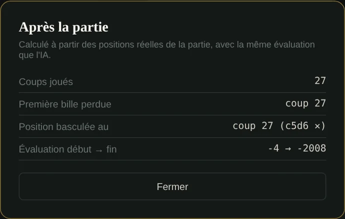
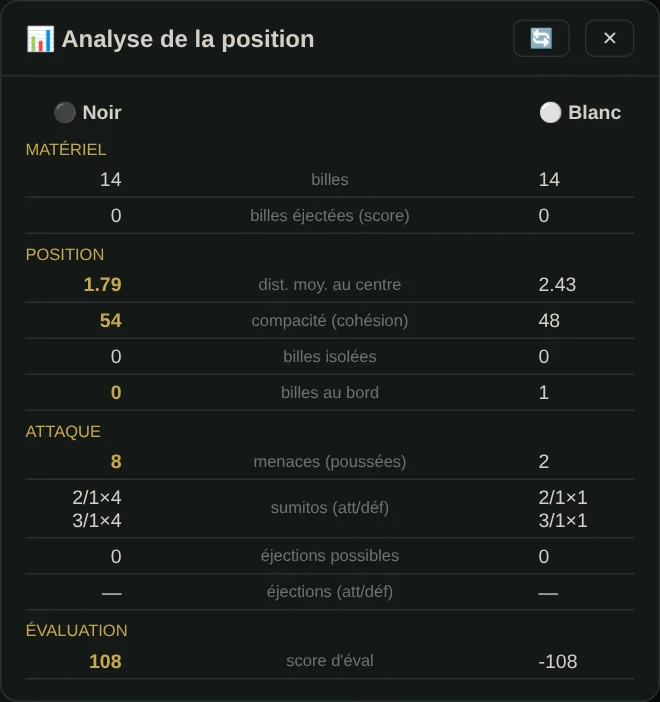
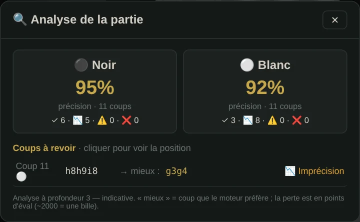
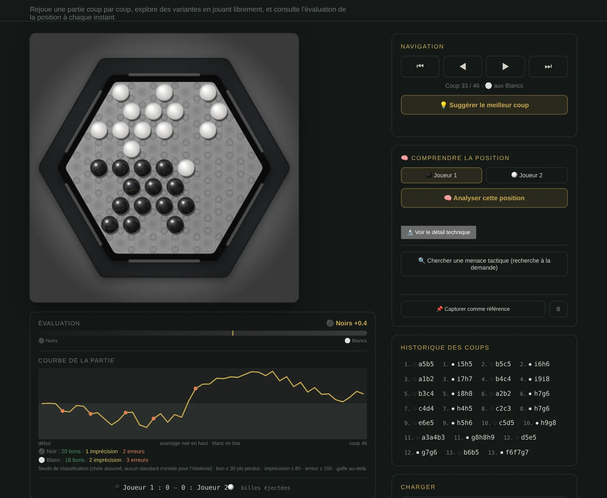
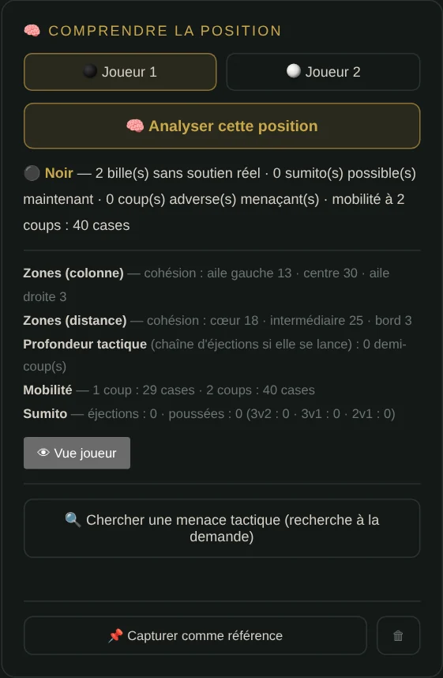

🇬🇧 [English version](../docs-en/Analyse.en.md)

# Analyser une partie

Quatre outils, du plus rapide au plus complet. Les captures viennent du vrai site, sur une vraie partie jouée contre l'IA.

| Outil | Où | Ce qu'il répond |
|---|---|---|
| [Après la partie](#après-la-partie) | Partie → **Analyse d'après-partie** | Où la partie a-t-elle basculé ? |
| [Analyse de la position](#analyse-de-la-position) | Partie → **📊 Analyse de la position** | Qui est mieux, ici, et pourquoi ? |
| [Analyser la partie](#analyser-la-partie-coup-par-coup) | Partie → **🔍 Analyser la partie** | Quels coups étaient des erreurs, et que fallait-il jouer ? |
| [Page Analyse](#la-page-analyse) | Menu → **Analyse** | Rejouer, explorer, comprendre une position |

Pour suivre **la réflexion de l'IA** elle-même, voir [Observatoire IA](Observatoire-IA.fr.md) (pendant le calcul) et [Réflexion de l'IA](Reflexion-IA.fr.md) (le tableau après le coup).

## Après la partie

Le résumé le plus court. Il rejoue les positions **réellement traversées** pendant la partie avec la même évaluation que l'IA, du point de vue du joueur humain, et donne :

- le nombre de coups joués ;
- le coup où **la première bille a été perdue** ;
- le coup où **la position a basculé** : la plus forte chute d'évaluation entre deux positions qui se suivent ;
- l'évaluation au début et à la fin.

Rien n'est recalculé par une recherche : c'est instantané.

## Analyse de la position

Sur la position du plateau, les deux camps face à face : **matériel** (billes, billes éjectées), **position** (distance moyenne au centre, compacité, billes isolées, billes au bord), **attaque** (poussées possibles, sumitos par type, éjections possibles) et le **score d'évaluation**. La valeur la meilleure de chaque ligne est en or. Le bouton 🔄 la recalcule après un coup.

## Analyser la partie, coup par coup

Pour **chaque coup de la partie**, le moteur cherche à **profondeur 3** depuis la position d'avant, note tous les coups possibles et compare le coup joué au meilleur. La **perte** est l'écart entre les deux, en points d'évaluation (une éjection vaut 2000 points). Le rapport donne :

- **la précision de chaque camp** : 100 × e^(−perte moyenne / 500), et le compte des coups par catégorie ;
- **les coups à revoir** (perte de plus de 120 points, les 10 plus coûteux) : le coup joué, celui que le moteur préfère, et la catégorie. **Un clic** rejoue la position sur le plateau.

| Catégorie | Perte |
|---|---|
| ✓ Meilleur | 0 |
| Précis | jusqu'à 30 |
| Correct | jusqu'à 120 |
| 📉 Imprécision | jusqu'à 600 |
| ⚠️ Erreur | jusqu'à 1 800 |
| ❌ Gaffe | au-delà |

À profondeur 3, l'avis est **indicatif**, et le rapport le dit. Sur une longue partie, l'analyse prend un moment : une recherche par coup joué.

## La page Analyse

**Charger** : ta dernière partie, la position de l'éditeur ou la position de départ. Puis :

- **Navigation** coup par coup (⏮ ◀ ▶ ⏭). Sur le plateau, on peut **jouer librement** pour explorer une variante.
- **Évaluation** de la position à chaque instant, et la **courbe de la partie** : avantage noir en haut, blanc en bas. Une chute verticale marque une erreur ; les points colorés classent les coups (bon, imprécision, erreur, gaffe) et un clic saute à ce coup.
- **💡 Suggérer le meilleur coup** pour la position affichée.
- **🧠 Comprendre la position**, pour l'un ou l'autre camp : billes sans soutien réel, sumitos possibles, coups adverses menaçants, mobilité à 2 coups.
- **🔍 Chercher une menace tactique** : une recherche ciblée, seulement à la demande.
- **📌 Capturer comme référence** : l'empreinte de la position (12 dimensions, la même pour une position et son miroir gauche-droite), à comparer à toutes les positions visitées ensuite.
- **🔬 Voir le détail technique** : les chiffres bruts derrière chaque résumé.

### Deux classements, deux mesures

La courbe de la page Analyse et le rapport « Analyser la partie » ne mesurent pas la même chose :

- **la courbe** regarde de combien **l'évaluation de la position** baisse d'un coup à l'autre, sans recherche ; seuils : bon jusqu'à 30, imprécision jusqu'à 80, erreur jusqu'à 200, gaffe au-delà ;
- **le rapport** compare le coup joué **au meilleur coup trouvé par une recherche** à profondeur 3 ; seuils du tableau ci-dessus.

Un même coup peut donc être classé différemment par les deux. Les deux échelles sont des choix assumés : il n'existe pas de standard pour l'Abalone.
