🇬🇧 [English version](../docs-en/Architecture.en.md)

# Architecture — les schémas

Trois cartes pour comprendre comment Abalassembly est construit. Elles sont **écrites à la main** et doivent être mises à jour quand l'architecture change — contrairement à la « Fiche pour IA » du site, qui compte tout à l'exécution.

Vérifié contre le code au moment de la rédaction (v2.45) ; schéma 1 revu en v2.60.

---

## 1. Comment l'IA choisit son coup

L'ordre compte : chaque étape n'est atteinte que si la précédente n'a rien donné.

```mermaid
flowchart TD
    A[Tour de l'IA] --> B{Livre d'ouvertures<br/>couvre la position ?}
    B -->|oui| B1[Coup tiré au sort,<br/>pondéré fréquence × taux de victoire]
    B -->|non| C{Moins de 20 coups joués ?}
    C -->|oui| C1{La même position existe<br/>dans une partie réelle ?<br/>vérifiée en la rejouant}
    C1 -->|oui| C2[Coup joué depuis<br/>cette position]
    C1 -->|non| D
    C -->|non| D{Moins de 16 coups<br/>et livre statique ?}
    D -->|oui| D1[Coup du livre statique]
    D -->|non| E{Niveau 1 ?}
    E -->|oui| E1[Coup au hasard<br/>parmi les 4 meilleurs]
    E -->|non| F[Recherche alpha-bêta]
    F --> G{Plusieurs cœurs<br/>disponibles ?}
    G -->|oui| G1[Recherche répartie<br/>sur plusieurs workers]
    G -->|non| G2[Recherche sur un worker]
    G1 --> H[Coup joué]
    G2 --> H
    B1 --> H
    C2 --> H
    D1 --> H
    E1 --> H

    style B1 fill:#3a3a1a
    style C2 fill:#3a3a1a
    style D1 fill:#3a3a1a
    style F fill:#1a3a3a
```

**À noter** : le repli par les parties réelles, entre les deux livres, est facile à oublier — il ne s'active que dans les vingt premiers coups, quand le livre principal a perdu la trace de la partie mais que la **même** position (atteinte dans un autre ordre) existe dans le corpus. Les empreintes ne servent qu'à trouver les candidates : chacune est vérifiée en rejouant sa partie, et le coup joué ensuite dans cette partie n'est retenu que s'il ne ramène pas une position déjà vue et ne défait pas le coup précédent du même camp. Même règle pour les deux livres. Jusqu'à la v2.59, ce repli prenait la position historique *la plus proche*, sans seuil : il jouait des coups d'autres parties, souvent d'une autre disposition, et faisait des allers-retours (h9g8 puis g8h9).

---

## 2. D'où viennent les données

Tout part du même corpus de parties réelles, embarqué dans le fichier.

```mermaid
flowchart LR
    S1[MIGS<br/>2 589 parties] --> C[Corpus<br/>4 479 parties réelles]
    S2[AbalOnline<br/>1 890 parties<br/>18 variantes] --> C

    C --> O[Livres d'ouvertures<br/>13 variantes]
    C --> E[Empreintes historiques<br/>418 595 positions × 12 dimensions]
    C --> P[Puzzles<br/>138, chacun sourcé]
    C --> ST[Statistiques du jeu<br/>avantage 1er joueur, durées...]

    O --> AI[Moteur]
    E --> AN[Analyse de partie]
    E --> AI
    P --> EN[Entraînement]
    ST --> W[Page Stats du jeu]

    style C fill:#3a3a1a
    style AI fill:#1a3a3a
```

Le corpus n'est pas seulement une bibliothèque à consulter : il alimente directement le jeu de l'IA (livres d'ouvertures, repli par empreintes) et l'analyse.

---

## 3. Les modes de jeu et les échanges

```mermaid
flowchart TD
    M[Écran de configuration] --> A1[Contre l'IA]
    M --> A2[Deux joueurs<br/>même appareil]
    M --> A3[Partie en direct<br/>WebRTC, expérimental]

    A1 --> G[Partie en cours]
    A2 --> G
    A3 --> G

    G --> X1[Partie par code<br/>texte à copier-coller]
    G --> X1b[Lien de partie<br/>?partie= dans l'URL, un clic]
    G --> X2[Export/import Aba-Pro<br/>standard communautaire]
    G --> X3[Duel moteur externe<br/>relais manuel des coups]
    G --> X4[Historique local<br/>200 parties, rejouables]

    X2 -.->|aucun serveur| EXT[Autre programme<br/>d'Abalone]
    A3 -.->|connexion directe| P2[Autre appareil]

    style G fill:#3a3a1a
    style A3 fill:#3a2a1a
```

Aucun de ces échanges ne passe par un serveur de jeu. « Partie par code », le lien direct et l'export Aba-Pro fonctionnent même sans réseau du tout — il suffit de transmettre un texte ou une URL. Le lien encode le même code de partie que « Partie par code », juste porté par l'URL plutôt que copié à la main.

---

## Ce qui est à part : les tablebases

Les tables de finale (2 contre 2, 3 contre 2) **ne sont pas branchées sur le moteur principal**. Elles servent au mode Découverte, à la page qui documente leur calcul, et depuis peu au trainer de puzzles « Finale prouvée » (positions où le gain est démontré par induction rétrograde, pas estimé par le moteur).

C'est délibéré : les classes supérieures sont hors de portée (voir [Calcul distribué](Calcul-distribue.fr.md) pour les tailles), et le résultat principal de ces tables est un constat plutôt qu'un gain de force — **99,9 % des positions 2v2 et 3v2 sont des nulles**.

---

## Ce que ces schémas ne montrent pas

- Le détail de l'évaluation (huit poids ajustés par SPSA) — voir [Moteur expérimental](Moteur-experimental.fr.md)
- Pourquoi le NNUE n'est pas activé par défaut — voir la mesure du 0/53 sur la même page
- Les limites du multi-worker — voir [Moteur multi-worker](Moteur-multi-worker.fr.md)
