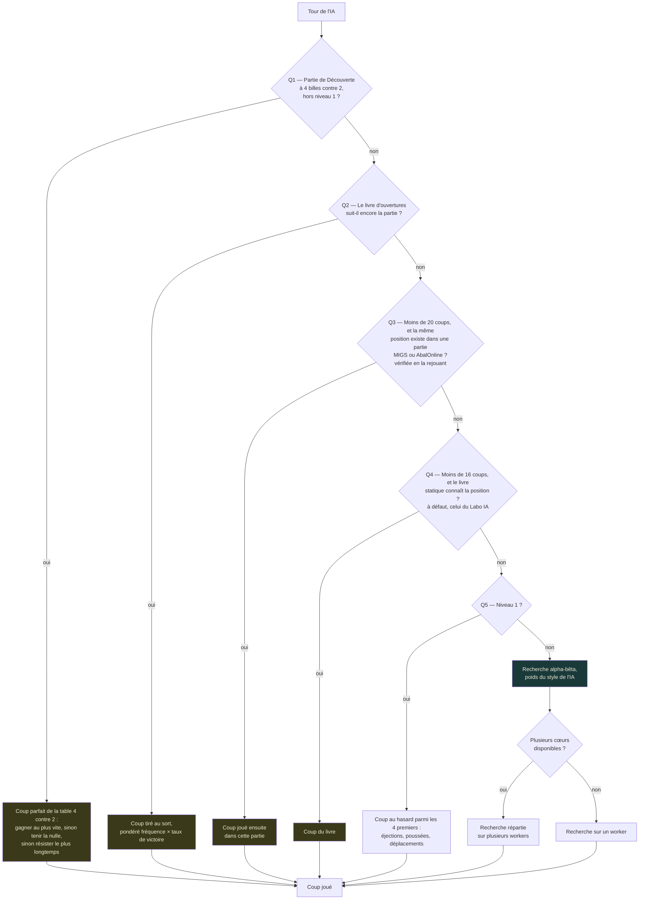
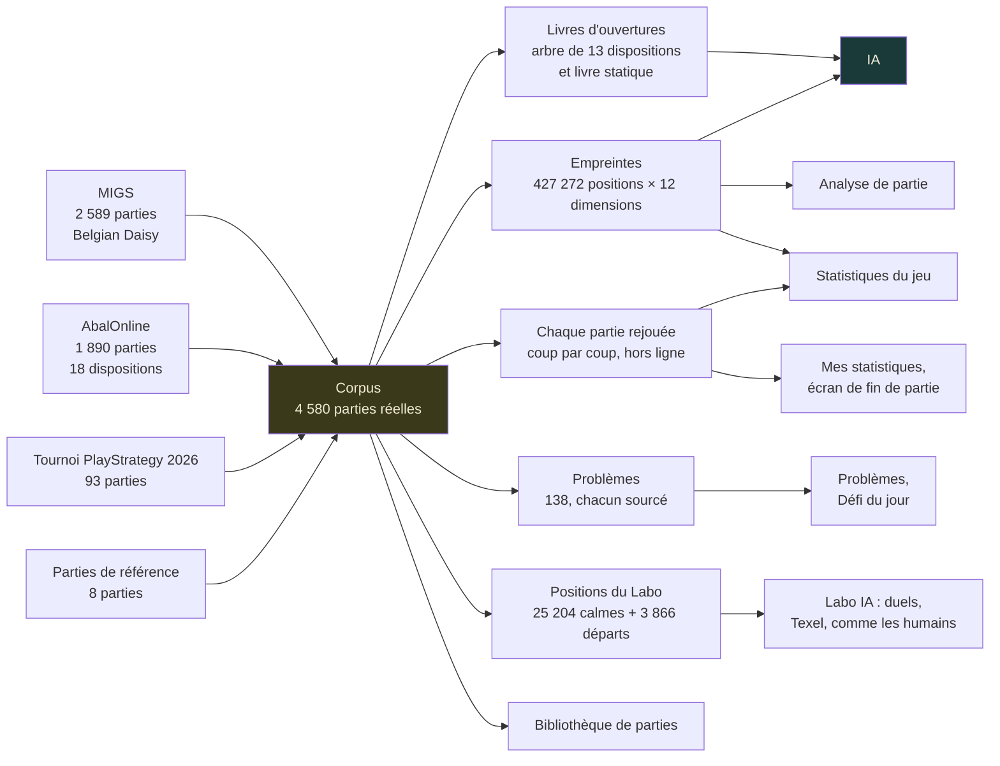
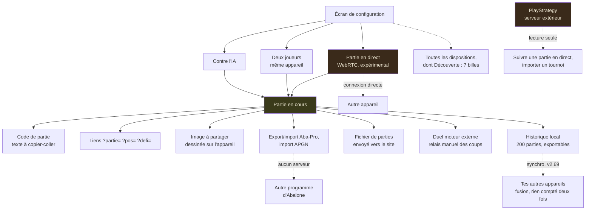

🇬🇧 [English version](../docs-en/Architecture.en.md)

# Architecture — les schémas

Quatre cartes pour comprendre comment Abalassembly est construit. Elles sont **écrites à la main** et doivent être mises à jour quand l'architecture change — contrairement à la « Fiche pour IA » du site, qui compte tout à l'exécution. La page Architecture du site en donne la version courte, en français et en anglais.

Vérifié contre le code en v2.66. Les chiffres de la page du site sont regroupés dans `ARCHI_CHIFFRES` (`src/main/34-architecture-diagrams-briefing.js`), et un test les compare aux données embarquées : une partie ou un problème de plus, et le test demande la mise à jour.

---

## 1. Comment l'IA choisit son coup

Les questions sont posées dans l'ordre (`aiMove()`) : dès qu'une réponse est oui, l'IA joue le coup trouvé ; sinon, elle passe à la suivante.

**À noter :**

- **La question 1** n'existe que depuis la v2.49 : en mode Découverte (7 billes par camp), dès qu'une partie arrive à 4 billes contre 2, l'IA ne calcule plus, elle lit la table de finale (voir plus bas). Au niveau 1, elle ne la consulte pas. Si un morceau de la table manque, il est chargé puis l'IA rejoue ; si le chargement échoue (pas de réseau), l'IA habituelle prend le relais.
- **Jamais un coup qui revient en arrière** (v2.60) : aux questions 2, 3 et 4, un coup qui ramène une position déjà vue ou défait le coup précédent du même camp n'est jamais retenu ; au niveau 1, seulement s'il n'y a pas d'autre choix parmi les 4.
- **Le repli par les parties réelles** (question 3), entre les deux livres, est facile à oublier : il ne s'active que dans les vingt premiers coups, quand le livre principal a perdu la trace de la partie mais que la **même** position (atteinte dans un autre ordre) existe dans une partie MIGS ou AbalOnline. Les empreintes ne servent qu'à trouver les candidates : chacune est vérifiée en rejouant sa partie. Jusqu'à la v2.59, ce repli prenait la position historique *la plus proche*, sans seuil : il jouait des coups d'autres parties, souvent d'une autre disposition, et faisait des allers-retours (h9g8 puis g8h9).
- **Le niveau 1** ne tire pas parmi les 4 *meilleurs* coups : il trie la liste par sorte (éjections d'abord, puis poussées, puis déplacements) et tire parmi les 4 premiers.
- **Le style** : la recherche utilise les poids du style choisi pour l'IA, ou, en mode adaptatif, celui déduit de ta façon de jouer (tu exposes tes billes : l'IA divise ; tu attaques fort : elle se solidifie ; tu joues passif : elle presse).

---

## 2. D'où viennent les données

Tout part des vraies parties embarquées dans le fichier.

**Précisions :**

- Les **livres d'ouvertures** et le repli de l'IA (question 3) ne lisent que les parties MIGS et AbalOnline (418 595 positions). Les 8 677 positions des parties PlayStrategy et de référence s'y ajoutent pour les 12 dimensions des Statistiques du jeu (v2.59), d'où 427 272.
- **Chaque partie rejouée** : `tools/stats-parties.js` rejoue hors ligne, avec le vrai moteur, les 4 580 parties (éjections, sortes de coups, occasions, les 12 dimensions des deux camps aux 20ᵉ, 40ᵉ et 60ᵉ coups) ; le résultat est embarqué compressé. Il nourrit la page Statistiques du jeu (les billes qui tombent, ce qui fait gagner, comment jouent les vrais joueurs — v2.63 à v2.65), les comparaisons de Mes statistiques et la ligne de l'écran de fin de partie. Un test rejoue un échantillon et compare.

- **Positions du Labo** (v2.70) : `tools/labo-positions.js` rejoue hors ligne les parties complètes et garde, pour chacune, jusqu'à 6 positions calmes (aucune éjection possible pour le camp au trait), avec le coup joué et le résultat, et une position de départ entre le 8ᵉ et le 16ᵉ demi-coup, à 0-0. Les duels du Labo partent de ces positions (Marguerite belge par défaut) ; la méthode Texel règle les poids sur les résultats ; « Comme les humains » et « Contre toi » sur les coups joués. Un test vérifie qu'elles suivent le corpus.

Le corpus n'est pas seulement une bibliothèque à consulter : il alimente directement le jeu de l'IA, l'analyse et les statistiques.

---

## 3. Les modes de jeu et les échanges

Le site n'a pas de serveur de jeu. Le code de partie, les liens, l'image, les exports et le fichier d'historique marchent même sans réseau : il suffit de transmettre un texte, une adresse, une image ou un fichier. Le lien `?partie=` encode le même code que « Partie par code », juste porté par l'adresse ; `?pos=` porte une position, `?defi=` un défi du jour.

**Trois choses à savoir :**

- **La partie en direct** relie les deux navigateurs directement (WebRTC). Les codes de connexion s'échangent à la main ; un serveur public (STUN) aide seulement les deux appareils à se trouver.
- **Synchroniser mes appareils** (v2.69) : la même connexion directe que la partie en direct, ou un fichier. Les deux appareils fusionnent leurs données de jeu (historique, progression, problèmes, cartes de chaleur…) : les parties s'ajoutent sans doublon, une suppression se propage, et chaque compteur garde la part de chaque appareil (un compteur « G-counter ») pour que rien ne soit compté deux fois. Les réglages, le Labo et la partie en cours restent sur chaque appareil.
- **PlayStrategy** (v2.48) : suivre une partie en direct, voir les tournois, en importer un. Le site interroge le serveur de PlayStrategy en lecture seule ; il n'envoie rien d'autre qu'un pseudo ou un lien.

---

## 4. Les tables de finale

Une partie normale (14 billes par camp) n'arrive jamais à ces finales : elle s'arrête dès qu'un camp a perdu 6 billes. Elles servent au **mode Découverte**, joué avec 7 billes, où un camp perd quand il tombe à 1 bille.

| Table | Ce qu'elle dit | Où elle sert |
|---|---|---|
| 2 contre 2, 3 contre 2 | **99,9 % de nulles** (2v2 : 99,90 % ; 3v2 : 99,85 %) | Découverte, page Tables de finale, trainer « Finale prouvée » (gain démontré par induction rétrograde, pas estimé) |
| 4 contre 2 (v2.49) | **Résolue et prouvée** : 140 575 680 positions, chacune recontrôlée. Avec le trait, le camp fort gagne toujours, en 97 demi-coups au plus | **L'IA en Découverte** (question 1), verdict « les Noirs gagnent en N demi-coups », page Tables de finale, Trainer |
| 3 contre 3 | Calculée et validée : 2 positions gagnantes sur 224 millions | Pas mise en ligne |
| 4 contre 3 et au-delà | ~2,5 milliards de positions après symétrie | Hors de portée d'un site en un seul fichier |

La table 4 contre 2 n'est pas dans le fichier : elle est découpée en 689 morceaux (`tablebase/4v2/`, 45 Mo en tout), chargés depuis le site quand une partie y arrive, chacun vérifié par son empreinte SHA-256. Détails : `tablebase/RESULTS.md` et [Calcul distribué](Calcul-distribue.fr.md).

---

## Ce que ces schémas ne montrent pas

- Le détail de l'évaluation (huit poids ajustés par SPSA) — voir [Moteur expérimental](Moteur-experimental.fr.md)
- Pourquoi le NNUE n'est pas activé par défaut — voir la mesure du 0/53 sur la même page
- Les limites du multi-worker — voir [Moteur multi-worker](Moteur-multi-worker.fr.md)
- Comment les empreintes sont calculées — voir [Empreintes historiques](Empreintes-historiques.fr.md)
