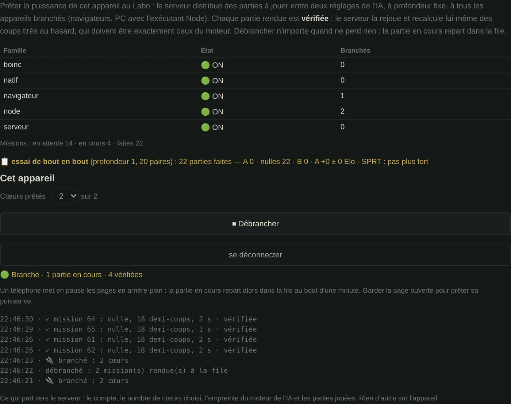

🇬🇧 [English version](../docs-en/Calcul-distribue.en.md)

# Calcul distribué

*Depuis la v3.18*, Abalassembly a un **réseau de calcul** : un ordonnanceur sur le serveur et des exécutants qu'on branche et débranche (des navigateurs, des PC). Il est construit et testé, mais **pas encore ouvert** : le serveur n'est pas hébergé. Plus bas, l'étude d'avant la v3.18, qui concluait qu'il ne fallait pas le faire, reste valable sur la plupart des points. Voici ce qui a changé.

## Depuis la v3.18 : l'ordonnanceur

**Un vrai besoin de calcul est apparu.** Départager deux réglages de l'IA demande des centaines de parties. En novembre 2026, les duels des poids Texel recalculés contre ceux du jeu ont pris environ 2 h 30 pour 40 paires, sur 2 cœurs. Ce sont des parties indépendantes : exactement ce qui se répartit bien. À vitesse égale, dix navigateurs à 4 cœurs feraient ce travail en moins de 10 minutes.

**Le problème de la vérification est réglé sans tout calculer deux fois.** Une partie du Labo à profondeur fixe se refait maintenant coup pour coup, sur n'importe quel appareil :
- les clés de hachage du moteur sortent d'une graine fixe ;
- le plateau est remis dans l'ordre des cases avant chaque recherche. Avant, l'ordre des billes dans la mémoire changeait d'une recherche à l'autre, et avec lui le choix entre deux coups de même note.

Vérifié sur 116 demi-coups recalculés un à un dans un fil neuf, jusqu'à la profondeur 3, sans un seul écart. Le serveur rejoue donc chaque partie rendue et recherche lui-même trois demi-coups tirés au hasard, que l'exécutant ne connaît pas à l'avance : un coup qui n'est pas celui du moteur, et la partie est refusée.

**Comment ça marche**
- **Le Labo crée une campagne** : deux jeux de poids, une profondeur, un nombre de paires. Chaque paire joue la même ouverture, couleurs échangées.
- **Chaque partie est une mission.** Le serveur la confie à un exécutant branché, avec un bail d'une minute renouvelé tant qu'il donne signe de vie.
- **Débrancher n'importe quand ne perd rien** : la mission repart dans la file.
- **Les interrupteurs** : une famille entière (tous les navigateurs, tous les PC Node) ou un seul exécutant, pour l'administrateur ; « Brancher / Débrancher » pour chaque joueur.
- **Le choix tient compte de la vitesse mesurée** de chaque appareil : une partie trop longue pour un téléphone va à un PC.



Le plan d'ensemble du réseau est dans les [Plans du site](Plans.fr.md#2-le-réseau-de-calcul).

*Capture faite avec un serveur de test sur la même machine, la page en ligne ne pouvant pas encore s'y connecter.*

**Dans le jeu**, c'est l'onglet **🌐 Réseau de calcul** du Labo : se connecter, choisir le nombre de cœurs prêtés, brancher. Tant que le serveur n'est pas en ligne, l'onglet le dit et **rien ne part** de l'appareil. Ce qui part, une fois branché : le compte, le nombre de cœurs, l'empreinte du moteur et les parties jouées. Sur un PC, l'exécutant Node du dépôt `abalassembly-api` fait la même chose en ligne de commande.

**Ce qui reste fermé**, avec la même rigueur qu'avant :
- les tables de finales au-delà de 3v3 (voir ci-dessous) ;
- l'entraînement d'un réseau de neurones ;
- la répartition d'une recherche en direct entre plusieurs machines (trop de dépendances entre les branches, trop de latence) ;
- les cartes graphiques (CUDA, WebGPU) : l'alpha-bêta n'en profite pas.

## Depuis la v3.24 : l'auto-jeu, la base d'un réseau de neurones « en ombre »

Une campagne peut aussi être de type **auto-jeu** (Labo → 🌐 Réseau, administration) : un seul réglage de l'IA joue contre lui-même, chaque partie depuis sa propre ouverture de 8 demi-coups tirée au hasard. Il n'y a pas de vainqueur à désigner entre deux réglages ; le but est de produire beaucoup de parties variées, vérifiées par le serveur comme toutes les autres.

Le serveur en tire une **base de positions** (`scripts/exporter-positions.js` du dépôt `abalassembly-api`) : chaque position de chaque partie, avec le camp au trait, les billes sorties, le score du juge actuel et le résultat final vu du camp au trait (gagnée, nulle, perdue). Les positions de l'ouverture tirée au hasard sont marquées, pour pouvoir les écarter.

Cette base servira à entraîner un petit réseau de neurones qui ne remplacera **pas** le juge actuel : il tournera à côté, « en ombre », sur les mêmes positions, et on comparera les deux (scores, coups choisis, qui prédit le mieux la fin de la partie, plus gros désaccords). Le moteur qui joue reste celui d'aujourd'hui, et la vérification par recalcul reste valable, puisque le réseau ne décide d'aucun coup.

## L'étude d'avant la v3.18

Quatre propositions distinctes de « grille de calcul volontaire » (façon World Community Grid ou BOINC) avaient été étudiées. Aucune n'avait été retenue, et ses raisons restent justes pour ce qu'elles visaient : les tables de finales et l'entraînement d'un réseau de neurones. Le blocage tenait à ceci : **il n'existait aucun calcul qui justifie l'infrastructure**. Les duels du Labo, qui en sont un, sont devenus l'objet de la v3.18.

## Les tailles réelles des tablebases

C'est l'erreur commune aux quatre propositions : chacune sous-estimait massivement la taille des tablebases, et chacune en faisait son argument principal. Voici les chiffres calculés, pour un plateau de 61 cases :

| Classe | Positions | Stockage minimum (2 bits/position) |
|---|---|---|
| 2v2 — **déjà calculée** | 3 131 130 | ~1 Mo |
| 3v2 — **déjà calculée** | 59 491 470 | ~15 Mo |
| 3v3 | 1 110 507 440 | **278 Mo** |
| 4v3 | 15 269 477 300 | **3,8 Go** |
| 4v4 | 206 137 943 550 | **51,5 Go** |

Pour mémoire, le site entier pèse environ 7,8 Mo, tout compris. Même la classe 3v3, la plus modeste des trois restantes, dépasserait le fichier de trente-cinq fois.

Les écarts entre ces chiffres et ceux annoncés dans les propositions allaient d'un facteur 6 à un facteur 20 000. C'est systématiquement ce qui faisait s'effondrer chaque proposition une fois recalculée.

### Deux façons de compter, toutes les deux justes

Le tableau ci-dessus compte les placements **bruts** — combien de configurations de billes existent sur le plateau, sans tenir compte des symétries. C'est la bonne mesure pour donner l'échelle du problème.

Mais 2v2 et 3v2, une fois **réellement calculées**, n'occupent pas cet espace brut : elles exploitent les 12 symétries du plateau (rotations et réflexions) pour réduire le camp faible à ses seules positions canoniques, plus un facteur ×2 pour le trait. Concrètement :

| Classe | Espace brut (tableau ci-dessus) | Espace réduit (méthode réelle, validée) |
|---|---|---|
| 2v2 | 3 131 130 | 6 262 260 *(inclut le ×2 du trait, absent du brut)* |
| 3v2 | 59 491 470 | 11 703 240 |
| 3v3 | 1 110 507 440 | **224 721 560** |

La méthode réduite est celle qui a réellement produit les tables 2v2 et 3v2 déjà embarquées dans le jeu — revérifié en la relançant de zéro dans un bac à sable séparé et en comparant le résultat aux vraies données, position par position, sans un seul écart sur les dizaines de milliers d'entrées non nulles des deux tables.

**3v3 a été calculée avec cette même méthode**, une première : 224 721 560 positions résolues, dont seulement 2 gains et aucune perte forcée — le reste, des nulles. Un résultat surprenant mais cohérent : une capture depuis 3v3 retombe sur une position 3v2 presque toujours nulle (99,85 % du corpus), donc très peu de captures tombent par chance sur l'une des rares positions décisives. Les deux positions gagnantes ont été revérifiées indépendamment avec le moteur de jeu réel, pas seulement avec le calcul qui les a produites.

**Une hypothèse de la table 3v2 déployée, vérifiée pour la première fois plutôt que simplement héritée** : l'algorithme original ne teste jamais si le camp fort (3 billes) peut perdre — il suppose cette impossibilité sans la démontrer. Une bille noire isolée peut réellement être poussée par les deux billes blanches (confirmé avec le vrai moteur, sur une position construite à la main), mais une poussée simple ne réduit pas le nombre de billes. La vraie question — blanc peut-il forcer une éjection complète malgré une défense optimale — a été testée sur un échantillon de 158 043 positions noir-au-trait, couvrant les 180 orbites du camp faible : zéro cas où tous les coups de noir mèneraient à une victoire blanche confirmée. La table déployée tient, maintenant sur preuve.

**Ce que ça ne change pas** : 4v3 reste hors de portée d'un stockage en fichier unique même réduit par symétrie (environ 812 Mo estimés, contre 3,8 Go en brut) — toujours des dizaines de fois la taille du site entier. Un vrai obstacle supplémentaire, découvert en creusant : la moitié du calcul retrograde (le camp faible, quand c'est son tour de jouer) change de case dans la table à **chaque coup, sans exception** — un découpage en tranches indépendantes ne fonctionne donc pas, il faudrait garder toute la table en mémoire (ou en mémoire virtuelle avec un fichier d'échange) d'un bout à l'autre du calcul.

**Où ça en est concrètement** : 3v2 (déployée), 3v3 (calculée, validée, non déployée — 2 positions exploitables sur 224 millions) et **4v2 (résolue en septembre 2026 : avec le trait, le camp fort gagne toujours, en 97 demi-coups au plus)**. Le 4v2 ne dépendait que du 3v2 ; il a suffi d'environ 20 minutes en C sur un seul cœur (voir `tablebase/RESULTS.md`). Le 4v3, lui, dépend du 3v3 et du 4v2, et reste hors de portée du site : environ 2,5 milliards de positions après symétrie.

## Les quatre candidats de calcul, et pourquoi aucun ne tient

**Tablebases 3v3 et au-delà** — incompatibles avec l'architecture fichier unique, voir le tableau ci-dessus. Le projet s'est arrêté à 3v2 pour cette raison, et c'était le bon choix.

**Entraînement d'un réseau de neurones (NNUE)** — c'est le candidat qui revenait le plus souvent, présenté comme prioritaire. Il est écarté sur mesure, pas sur intuition : le réseau est **aveugle aux positions tactiques**, et ce n'est pas un problème de volume de données ni de puissance de calcul. Voir [Moteur expérimental](Moteur-experimental.fr.md), section « Pourquoi pas de NNUE — la mesure du 0/53 ». Ajouter de la puissance à un modèle qui rate systématiquement les éjections ne le corrigerait pas.

**Optimisation des poids par SPSA** — le Labo la fait déjà, en local, sur quelques workers. Elle n'a pas besoin de renfort extérieur.

**Génération de positions et analyse de parties** — le corpus de 4 479 parties réelles est déjà embarqué et exploité (livres d'ouvertures, empreintes historiques, statistiques). Rien n'attend d'être calculé.

## Deux contraintes d'architecture, vérifiées dans le code

**Les Workers sont créés depuis une chaîne embarquée**, jamais depuis un fichier séparé :

```js
const blob = new Blob([AI_WORKER_CODE], { type: 'application/javascript' });
_aiWorker = new Worker(URL.createObjectURL(blob));
```

Plusieurs propositions suggéraient un `distributed-worker.js` autonome. Un fichier séparé **casse le fonctionnement depuis `file://`** — donc depuis une clé USB, hors ligne, ce qui est le principe fondateur du projet.

**`SharedArrayBuffer` est inutilisable ici.** Il exige les en-têtes HTTP COOP/COEP, impossibles à définir sur GitHub Pages. C'est la même limite qui empêche déjà une table de transposition partagée entre workers (voir [Moteur multi-worker](Moteur-multi-worker.fr.md)).

## Le problème de la vérification

*(Réglé par la v3.18 : parties reproductibles, recalcul de demi-coups tirés au hasard par le serveur, voir plus haut.)*

Sans serveur, il n'existe aucun moyen de vérifier qu'un contributeur a réellement calculé ce qu'il renvoie. Un client malveillant — ou simplement buggé — pourrait retourner n'importe quoi.

Les vraies grilles (BOINC, World Community Grid) résolvent ça en distribuant la même tâche à plusieurs machines et en comparant les résultats. Cela suppose exactement le serveur central que l'architecture hors-ligne cherche à éviter, et double le coût de calcul.

Fusionner à la main des fichiers reçus par courriel n'est pas une grille de calcul : c'est du partage de fichiers, sans garantie sur leur contenu.

## Ce qui reste valable dans ces propositions

Trois points méritent d'être conservés pour le jour où la question se rouvrira :

**Le consentement strict.** Rien par défaut, case à cocher explicite, limite de puissance réglable, bouton d'arrêt immédiat, et texte clair sur ce qui est calculé. Un site qui ferait tourner du calcul sans accord explicite serait, à juste titre, traité comme un mineur caché.

**La validation redondante.** Même tâche distribuée à plusieurs machines, résultat retenu seulement si les réponses concordent ; plus des tâches de contrôle dont la réponse est connue d'avance.

**Commencer par un test de reproductibilité, pas par les tablebases.** Faire calculer des positions aléatoires à plusieurs navigateurs et vérifier qu'ils retrouvent exactement le même résultat. Cela teste toute la chaîne — distribution, calcul, validation — sans engager des semaines de calcul sur un objectif incertain. C'était le meilleur conseil des quatre documents.

## À quelles conditions la question se rouvrait

*(La première est remplie par les duels du Labo ; reste la seconde : héberger le serveur.)*

Deux, cumulatives :

1. **Un objectif de calcul réel** — quelque chose dont le résultat tiendrait dans le site et apporterait une amélioration mesurable. Aucun des quatre candidats actuels ne remplit ce critère.
2. **Un backend actif** — `abalassembly-api` existe mais reste volontairement dormant. Il est la condition de l'agrégation et de la vérification, et débloquerait au passage un vrai classement Elo.

En attendant, construire les interrupteurs « prêter mon processeur » reviendrait à promettre aux contributeurs un calcul dont personne n'a besoin.
