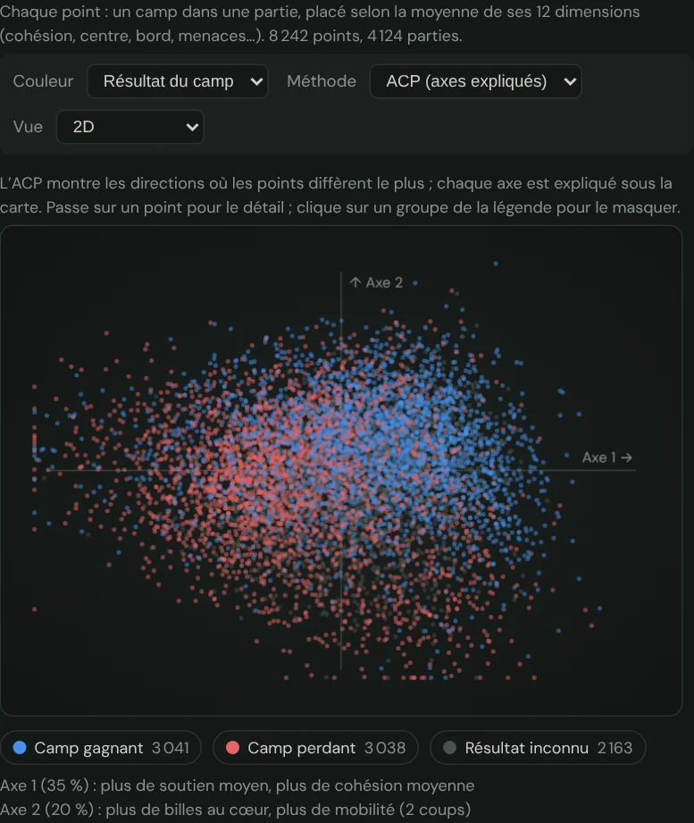

🇬🇧 [English version](../docs-en/Cartes-des-donnees.en.md)

# Les cartes des données

Depuis la v3.27, quatre pages dessinent leurs chiffres comme une carte : un nuage de points en couleur, en 2D ou en 3D tournante. Chaque point est une partie, un réglage du Labo ou une position. Deux points proches se ressemblent selon les 12 dimensions du jeu : cohésion, soutien, centre, bord, menaces, mobilité, etc. (voir [Empreintes historiques](Empreintes-historiques.fr.md)).

## Les quatre cartes

| Page | Un point, c'est… | Couleurs au choix | Un clic sur un point |
| --- | --- | --- | --- |
| Statistiques du jeu | un camp dans une partie du corpus (moyenne de ses positions) | résultat du camp, source, camp, longueur, joueurs | rejoue la partie |
| Mes statistiques | une de tes parties, au milieu de celles des vrais joueurs (en gris) | ton résultat, niveau de l'IA, ta couleur, quand | rejoue ta partie |
| Labo, tableau de bord | un réglage des 16 poids : champions, mutants adoptés, rejetés, indécis, écartés au tri, chemin du SPSA, mutants en test | verdict | — |
| Analyse | une position de la partie chargée, parmi 4 000 positions de vrais joueurs ; une ligne par camp, numérotée par demi-coup | camp | va à ce demi-coup |

La carte des Statistiques du jeu suit les filtres de la page (source, disposition, longueur, période, joueurs). Celle de Mes statistiques mesure tes parties une seule fois, sur demande (bouton « Dessiner ma carte »). Le résultat est gardé sur ton appareil. Celle de l'Analyse se dessine sur demande, pour la partie chargée.

## Deux façons de ramener 12 dimensions sur l'écran

- **ACP** (analyse en composantes principales) : instantanée. Elle montre les directions où les points diffèrent le plus, et chaque axe est expliqué sous la carte, par exemple « Axe 1 (35 %) : plus de soutien moyen, plus de cohésion moyenne ». Tes parties et la partie analysée se placent sur la carte des vrais joueurs sans la déplacer.
- **t-SNE** : regroupe les points qui se ressemblent, les paquets sont des familles de parties. Ses axes n'ont pas de sens, ni les distances entre paquets éloignés. Le calcul se fait dans un fil séparé, sur 1 200 points au plus (environ 10 secondes sur un PC), et la même entrée donne toujours la même carte.

## Lire et manipuler la carte

- **En 3D :** fais tourner la carte à la souris, au doigt ou aux flèches du clavier. Les touches + et − servent au zoom, et ⟲ remet la vue de départ.
- **Le détail d'un point :** passe la souris dessus.
- **Masquer un groupe :** clique dessus dans la légende.
- **Points extrêmes :** 99,5 % des points tiennent dans le cadre ; les rares autres sont posés sur son bord.
- **Les réglages** (méthode, vue, couleur) sont retenus sur ton appareil.

## Ce que la carte ne dit pas

Une carte résume : 12 nombres deviennent 2 ou 3. Deux points proches ont des moyennes proches, pas forcément des parties semblables coup par coup. La carte du Labo ne relève les mutants tranchés que depuis la v3.27 ; avant, seuls les champions et le chemin du SPSA étaient gardés.
