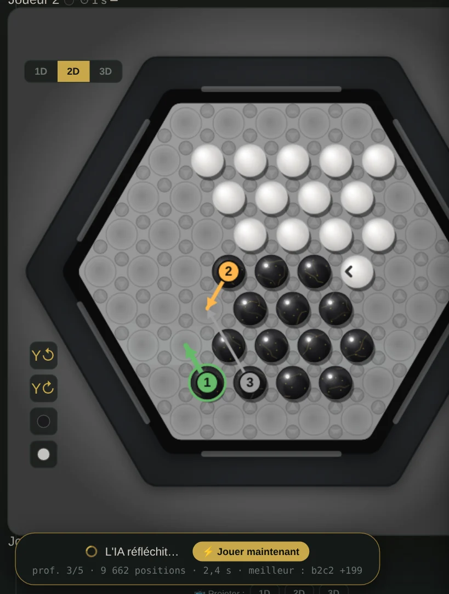
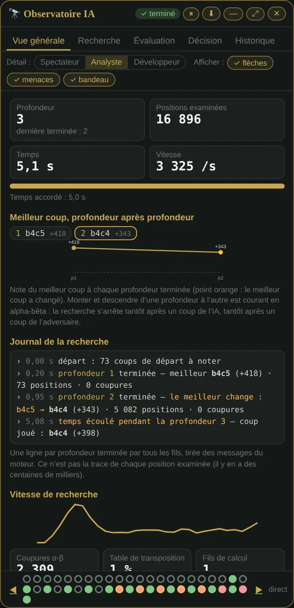
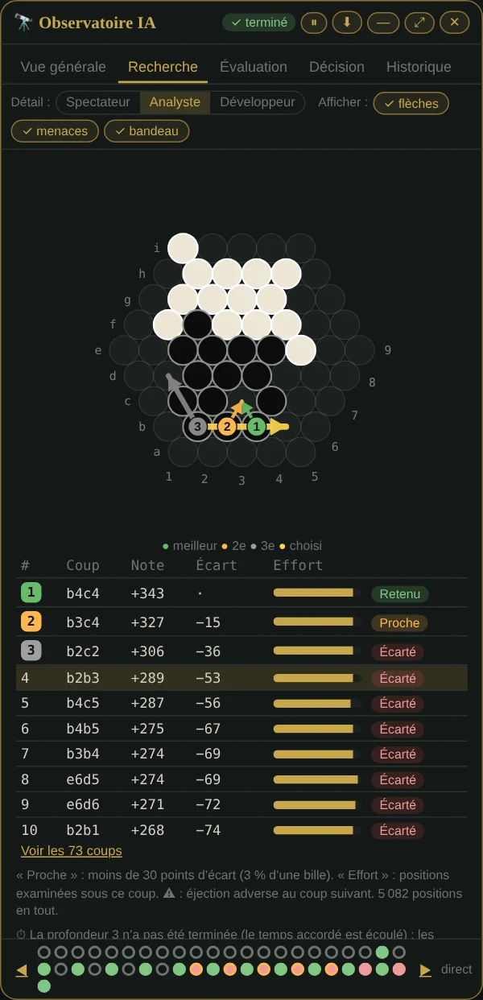
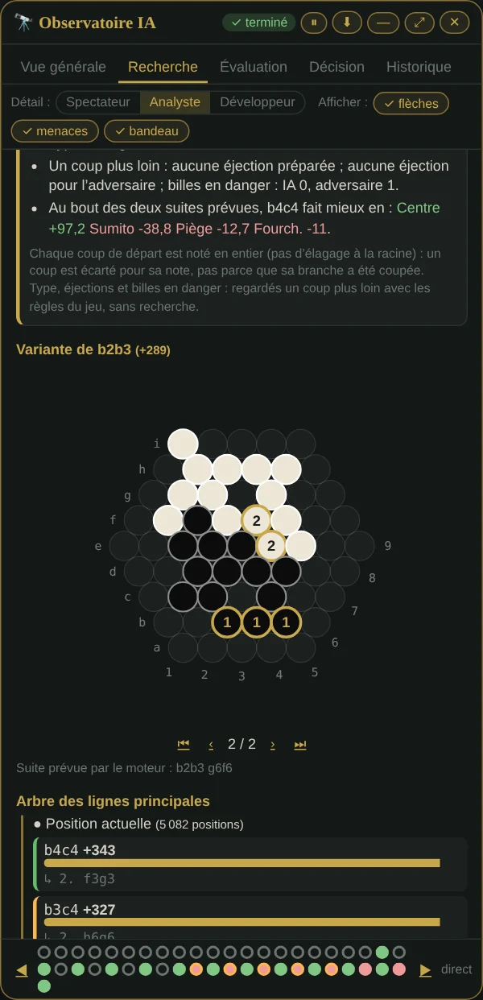
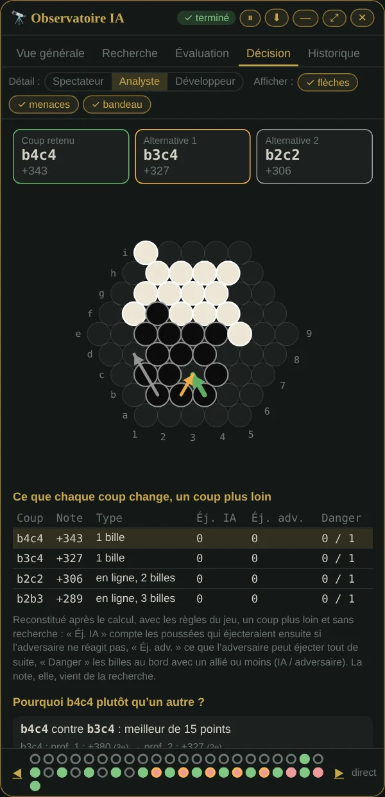
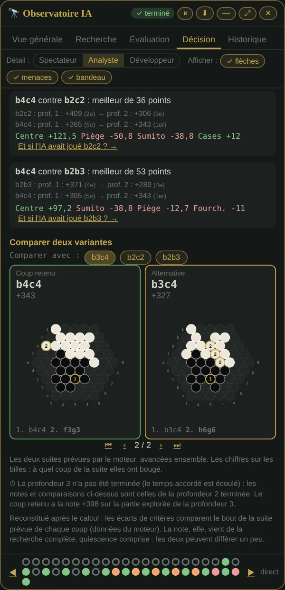
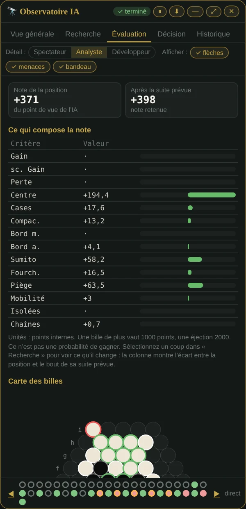
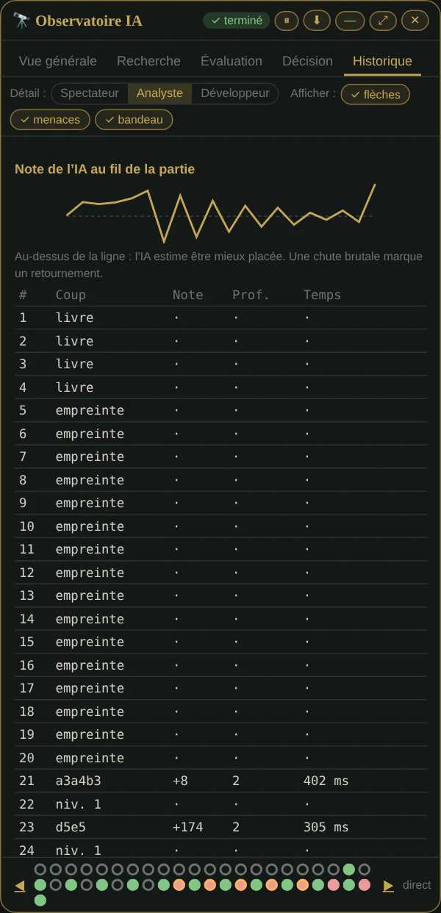
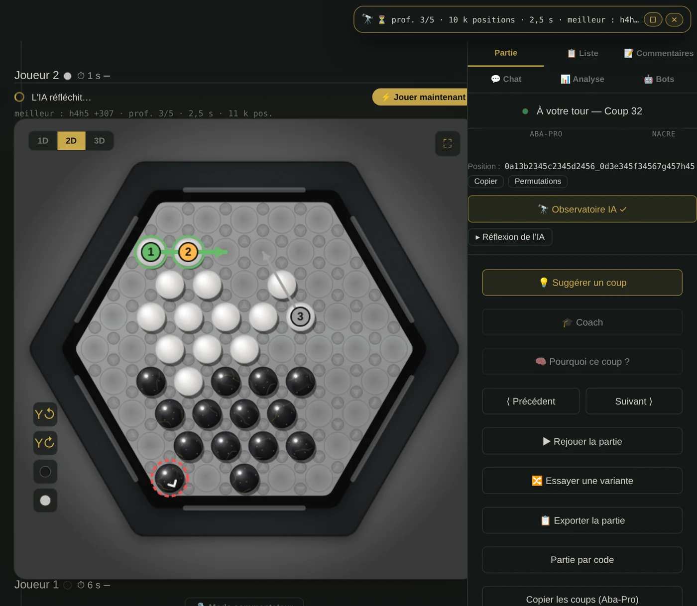
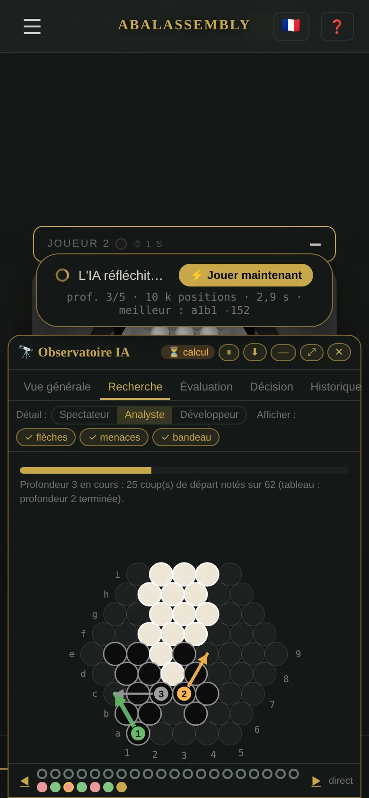

🇬🇧 [English version](../docs-en/Observatoire-IA.en.md)

# Observatoire IA

*Depuis la v3.05, enrichi jusqu'à la v3.09.* Un panneau qui montre ce que l'IA calcule **pendant** la partie, puis pourquoi elle a choisi son coup. Les captures ci-dessous viennent du vrai site, pendant une vraie partie contre l'IA.

**Pour l'ouvrir** : en partie contre l'IA, bouton **« 🔭 Observatoire IA »** sous le plateau. Le panneau se place à droite sur ordinateur et en bas sur téléphone. Il a cinq onglets et trois niveaux de détail : **Spectateur**, **Analyste**, **Développeur**.

> Le moteur n'est pas modifié dans ses choix : il envoie seulement ses mesures pendant le calcul (au plus toutes les 150 ms). Un test vérifie qu'il joue le même coup, avec les mêmes positions examinées, que le panneau soit ouvert ou non. Rien ne sort du navigateur.

## Le plateau de la partie, en direct

- **Les 3 meilleurs coups du moment**, en flèches numérotées comme la liste : **1** vert, **2** orange, **3** gris. Une flèche part de la dernière bille du groupe et va jusqu'à la case où arrive la première ; les billes du meilleur coup sont entourées.
- **Les billes menacées** des deux camps : en rouge, une bille au bord avec un allié ou moins ; en orange, une bille isolée. Ce sont les définitions de l'évaluation du moteur.
- **Le bandeau « L'IA réfléchit… »** : profondeur, positions examinées, temps et meilleur coup provisoire. Il s'affiche même panneau fermé.

Tout se règle sur la ligne sous les onglets : **Afficher : flèches, menaces, bandeau**.

## Vue générale

Profondeur atteinte, positions examinées, temps sur le temps accordé, vitesse. Puis :

- **le meilleur coup, profondeur après profondeur**, et la **courbe de sa note** (point orange quand le meilleur coup change) ;
- **le journal de la recherche** : une ligne par profondeur terminée, avec le meilleur coup, sa note, les positions et les coupures, et « le meilleur change » quand c'est le cas ; à la fin, le coup joué, et « temps écoulé pendant la profondeur N » si le minuteur a coupé ;
- la vitesse, les coupures alpha-bêta, la table de transposition, l'élagage par profondeur ; au niveau Développeur, le détail fil par fil.

## Recherche : les coups étudiés

Tous les coups de départ, avec leur note, leur écart avec le meilleur, l'effort de recherche passé dessous, et ⚠ quand l'adversaire a une éjection juste après. Le mini plateau porte les **coordonnées Aba-Pro** (lettres a à i, chiffres 1 à 9) pour lire la notation.

### « Pourquoi pas ce coup ? »

Cliquer un coup de la liste ouvre sa fiche. On n'y trouve que des faits :

- son rang et sa note, son écart avec le coup retenu, en points et en billes ;
- **sa note profondeur après profondeur**. S'il menait plus tôt puis recule, la fiche le dit : en cherchant plus loin, le moteur lui a trouvé une meilleure réponse adverse ;
- ce que montrent les règles **un coup plus loin** : type de coup, éjections préparées, éjections laissées à l'adversaire, billes en danger ;
- les critères qui diffèrent au bout des deux suites prévues, quand elles sont gardées.

En dessous, la **variante prévue**, coup par coup, sur un petit plateau.

## Décision : pourquoi ce coup plutôt qu'un autre

Le coup retenu et ses deux meilleures alternatives, en flèches de mêmes couleurs, puis un tableau : type de coup, éjections préparées par l'IA, éjections possibles pour l'adversaire, billes en danger de chaque camp. Ces colonnes sont **reconstituées après le calcul avec les règles du jeu, un coup plus loin, sans recherche** : le panneau le précise. La note, elle, vient de la recherche.

Plus bas, **deux variantes côte à côte**, avancées ensemble pas à pas. Les chiffres sur les billes disent à quel coup de la suite elles ont bougé.

## Évaluation : ce qui compose la note

Les critères de l'évaluation du moteur, avec leurs valeurs, en barres centrées sur zéro, et ce que change le coup choisi. La note est en **points internes** : une bille de plus vaut 1000 points, une éjection 2000. Ce n'est pas une probabilité de gagner.

## Historique et frise

La note de l'IA au fil de la partie, la liste de ses décisions, et **« Rejouer ce calcul plus profond »** pour un coup passé. En bas du panneau, dans tous les onglets, une **frise** : un point par coup de l'IA (rouge si la note est négative, cerclé d'orange après une chute d'au moins 200 points, vide sans calcul), un point qui pulse pendant le calcul, ◀ ▶ pour passer d'un coup à l'autre. Le rapport de la partie se **copie** ou se **télécharge** (.txt, et .json au niveau Développeur).

## Panneau réduit

Le bouton **—** réduit le panneau à une ligne : le plateau reste dégagé, avec ses flèches et ses billes menacées. Un clic sur la ligne le rouvre. Le bouton **⤢** fait l'inverse : les cinq onglets à la fois, en plein écran.

## Sur téléphone

Sur téléphone, le panneau s'ouvre en tiroir sur le bas de l'écran et le bandeau « L'IA réfléchit… » passe juste au-dessus. Le tiroir cache une partie du plateau : son mini plateau montre les mêmes flèches, et le bouton **—** le réduit à une ligne en haut pour revoir le plateau entier.

## Ce que le panneau ne prétend pas

- **Pas d'arbre complet** : le moteur ne garde pas les milliers de positions examinées. On montre les lignes principales des 10 meilleurs coups de départ.
- **Pas d'élagage à la racine** : chaque coup de départ est noté en entier. Un coup est écarté pour sa note, pas parce que sa branche a été coupée.
- **Pas de « confiance » en pourcentage**, ni de « mémoire utilisée » : on montre l'écart avec le 2e coup et le nombre de profondeurs où le choix est resté le même, des faits mesurés.

Voir aussi : [Réflexion de l'IA](Reflexion-IA.fr.md) (le tableau après le coup) et [Analyse](Analyse.fr.md) (analyser une partie).
