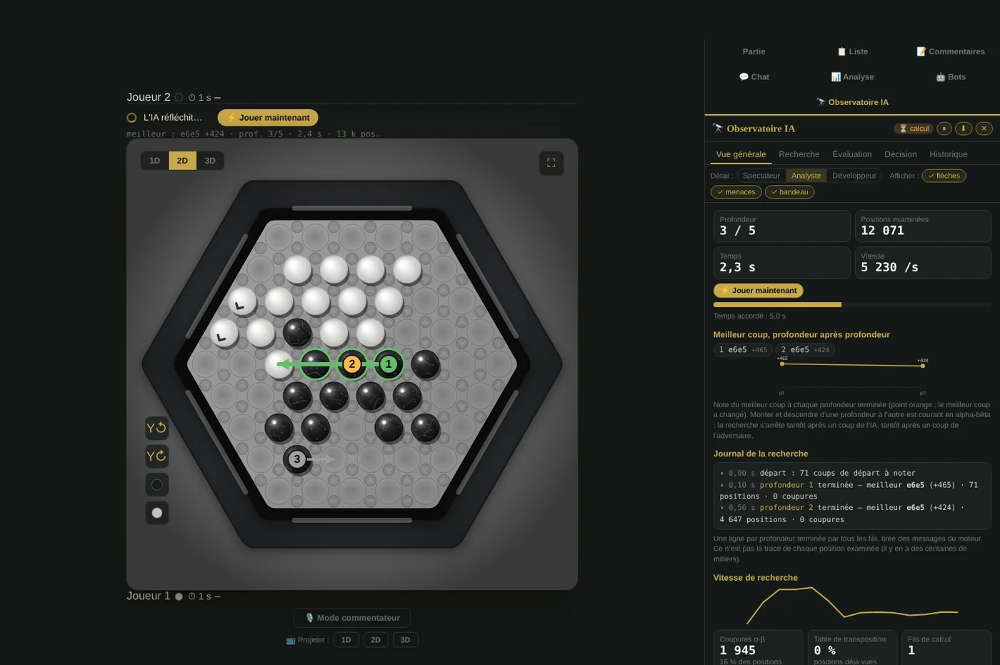
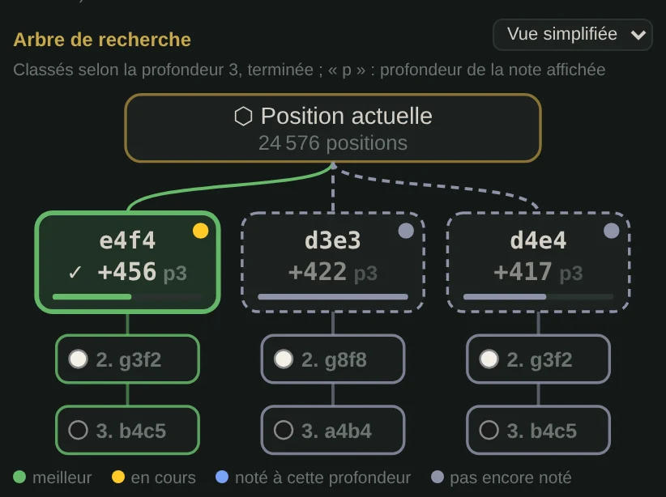
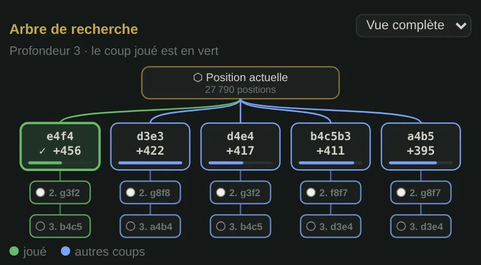
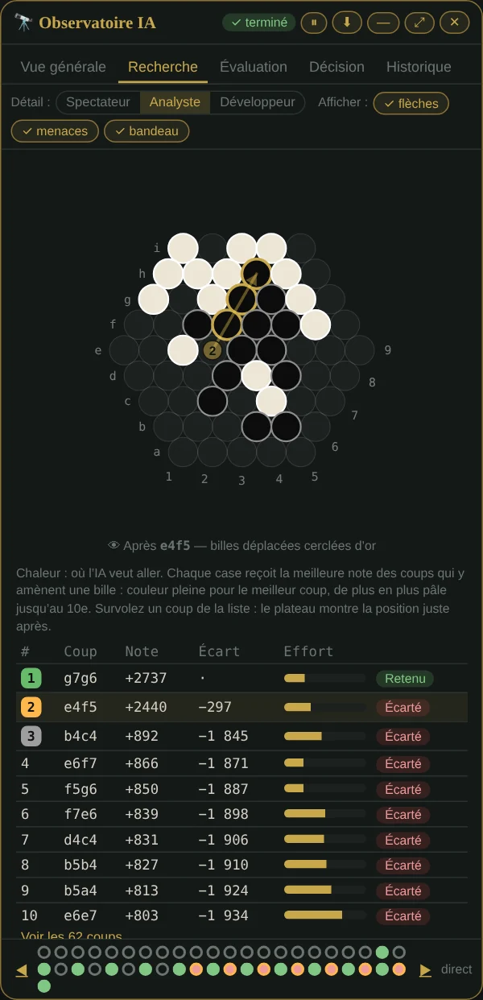
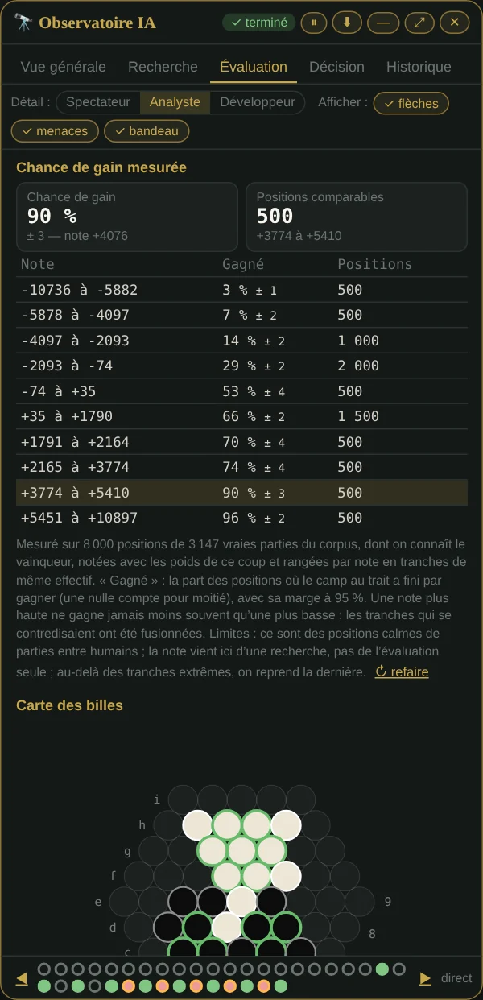

🇬🇧 [English version](../docs-en/Observatoire-IA.en.md)

# Observatoire IA

*Depuis la v3.05, enrichi jusqu'à la v3.17.* Un panneau qui montre ce que l'IA calcule **pendant** la partie, puis pourquoi elle a choisi son coup. Les captures ci-dessous viennent du vrai site, pendant une vraie partie contre l'IA.

**Pour l'ouvrir** : en partie contre l'IA, l'onglet **« 🔭 Observatoire IA »** de la colonne de droite (ou le bouton du même nom dans l'onglet Partie). *Depuis la v3.15*, ce n'est plus une fenêtre : l'Observatoire est un onglet de la colonne de droite, comme Liste ou Commentaires. Il a cinq onglets et trois niveaux de détail : **Spectateur**, **Analyste**, **Développeur**.

Sur ordinateur, il est à côté du plateau, et la colonne s'élargit tant qu'il est ouvert sur les écrans d'au moins 1 700 px. Sur téléphone, il est sous le plateau, comme les autres onglets. Passer à un autre onglet le ferme, et les flèches sur le plateau ne s'affichent que lorsqu'il est ouvert ; le site se souvient de l'onglet ouvert.

> Le moteur n'est pas modifié dans ses choix : il envoie seulement ses mesures pendant le calcul (au plus toutes les 150 ms). Un test vérifie qu'il joue le même coup, avec les mêmes positions examinées, que le panneau soit ouvert ou non. Rien ne sort du navigateur.

## Le plateau de la partie, en direct

- **Les 3 meilleurs coups du moment**, en flèches numérotées comme la liste : **1** vert, **2** orange, **3** gris. Une flèche part de la dernière bille du groupe et va jusqu'à la case où arrive la première ; les billes du meilleur coup sont entourées.
- **Les billes menacées** des deux camps : en rouge, une bille au bord avec un allié ou moins ; en orange, une bille isolée. Ce sont les définitions de l'évaluation du moteur.
- **« L'IA réfléchit… »**, dans la barre du joueur que joue l'IA (le joueur 2, en général), avec le bouton **⚡ Jouer maintenant** et une ligne de mesures : meilleur coup provisoire, profondeur, temps, positions examinées. *Depuis la v3.14*, cette zone reste dans la barre pendant toute la partie, pour que le plateau ne bouge pas : quand l'IA attend votre coup, elle rappelle son dernier calcul. Elle s'affiche même panneau fermé.

Tout se règle sur la ligne sous les onglets : **Afficher : flèches, menaces, bandeau**.

## Vue générale

Profondeur atteinte, positions examinées, temps sur le temps accordé, vitesse. Puis :

- **le meilleur coup, profondeur après profondeur**, et la **courbe de sa note** (point orange quand le meilleur coup change) ;
- **le journal de la recherche** : une ligne par profondeur terminée, avec le meilleur coup, sa note, les positions et les coupures, et « le meilleur change » quand c'est le cas ; à la fin, le coup joué, et « temps écoulé pendant la profondeur N » si le minuteur a coupé ;
- la vitesse, les coupures alpha-bêta, la table de transposition, l'élagage par profondeur ; au niveau Développeur, le détail fil par fil.

*Depuis la v3.17*, l'**arbre de recherche** y figure aussi, en vue simplifiée (voir ci-dessous) ; **détails →** ouvre l'onglet Recherche.

## Recherche : les coups étudiés

Tous les coups de départ, avec leur note, leur écart avec le meilleur, l'effort de recherche passé dessous, et ⚠ quand l'adversaire a une éjection juste après. Le mini plateau porte les **coordonnées Aba-Pro** (lettres a à i, chiffres 1 à 9) pour lire la notation.

### L'arbre de recherche

*Depuis la v3.17.* En haut de l'onglet : la position, ses meilleurs coups de départ en cases notées, et sous chacun la **suite que l'IA prévoit** (2. la réponse attendue, 3. la reprise…). La pastille noire ou blanche dit qui joue.

**Pendant le calcul, l'arbre se remplit.** Les coups sont classés selon la dernière profondeur terminée, pour que l'ordre ne saute pas. La pastille en haut à droite de chaque coup dit où il en est à la profondeur en cours :

- **jaune** : un fil de calcul le cherche en ce moment ;
- **bleue** : sa note à cette profondeur est connue, et c'est elle qui est affichée ;
- **grise**, cadre en pointillés : pas encore noté, il garde sa note précédente.

Le petit **p3**, **p4** à côté de la note dit de quelle profondeur elle vient. La barre sous la note montre l'effort de recherche passé sous le coup. Le cadre vert marque le meilleur coup du moment, puis le coup joué.

**Vue simplifiée** : 3 coups, 2 étages de suite. **Vue complète** (Analyste, Développeur) : 5 coups et toute la suite gardée ; sur un écran étroit, elle défile de côté. Le site se souvient de la vue choisie. Toucher un coup le choisit comme dans la liste. Une fois le coup joué, toucher une case de la suite montre le plateau à cette étape.

Deux choses des maquettes n'y sont pas, parce qu'elles seraient inventées. D'abord, **plusieurs réponses notées sous un coup** : le moteur ne garde que la réponse qu'il prévoit, et noter les autres voudrait dire recalculer. Ensuite, une **case « élaguée »** : aucun coup de départ n'est élagué, chacun est cherché en entier ; l'élagage se fait plus bas, et le moteur compte les coupures sans retenir lesquelles. Au niveau Développeur, les **10 lignes principales** restent listées en bas de l'onglet.

### Carte de chaleur : où l'IA veut aller

*Depuis la v3.12.* Les cases colorées en orange sont celles où les **10 meilleurs coups** amènent une bille. Chaque case prend la meilleure note des coups qui y mènent : couleur pleine pour le meilleur coup, de plus en plus pâle jusqu'au 10e. Une case déjà occupée (une bille poussée) est entourée d'un halo. Au survol d'une case, une bulle donne le coup et sa note. Le lien **🔥** sous le plateau la masque ou la remet.

### Aperçu au survol

*Depuis la v3.12, à la souris.* Survoler un coup de la liste (ou une branche de l'arbre) montre sur le mini plateau **la position juste après ce coup** : les billes déplacées sont cerclées d'or, la flèche pâle rappelle d'où elles viennent. La position est calculée avec les règles du site, sans recherche. Au doigt, toucher un coup le choisit, comme avant.

### « Pourquoi pas ce coup ? »

Cliquer un coup de la liste ouvre sa fiche. On n'y trouve que des faits :

- son rang et sa note, son écart avec le coup retenu, en points et en billes ;
- **sa note profondeur après profondeur**. S'il menait plus tôt puis recule, la fiche le dit : en cherchant plus loin, le moteur lui a trouvé une meilleure réponse adverse ;
- ce que montrent les règles **un coup plus loin** : type de coup, éjections préparées, éjections laissées à l'adversaire, billes en danger ;
- les critères qui diffèrent au bout des deux suites prévues, quand elles sont gardées.

En dessous, la **variante prévue**, coup par coup, sur un petit plateau.

## Décision : pourquoi ce coup plutôt qu'un autre

Le coup retenu et ses deux meilleures alternatives, en flèches de mêmes couleurs, puis un tableau : type de coup, éjections préparées par l'IA, éjections possibles pour l'adversaire, billes en danger de chaque camp. Ces colonnes sont **reconstituées après le calcul avec les règles du jeu, un coup plus loin, sans recherche** : le panneau le précise. La note, elle, vient de la recherche.

Plus bas, **deux variantes côte à côte**, avancées ensemble pas à pas. Les chiffres sur les billes disent à quel coup de la suite elles ont bougé.

## Évaluation : ce qui compose la note

Les critères de l'évaluation du moteur, avec leurs valeurs, en barres centrées sur zéro, et ce que change le coup choisi. La note est en **points internes** : une bille de plus vaut 1000 points, une éjection 2000. Ce n'est pas une probabilité de gagner.

### Chance de gain mesurée

*Depuis la v3.13.* Ce que vaut une note, **mesuré sur de vraies parties** : 8 000 positions du corpus dont on connaît le vainqueur, notées avec les poids du coup observé et rangées par note en tranches de même effectif. Pour chaque tranche, la part des positions où le camp au trait a fini par gagner (une nulle compte pour moitié), avec sa marge à 95 %. Une note plus haute ne gagne jamais moins souvent qu'une plus basse : les tranches qui se contredisaient sont fusionnées. Le bouton **📏 Mesurer sur les vraies parties** fait le calcul (environ une seconde sur ordinateur) ; le résultat reste dans le navigateur et s'affiche aussi dans la Vue générale et le rapport.

Une courbe unique (celle de la méthode Texel, p = 1 / (1 + e^(−s × note))) a d'abord été essayée : sur les parties de contrôle, une bille d'avance était prévue à 68 % et gagnait 95 % du temps. D'où des tranches mesurées plutôt qu'un modèle. Limites : ce sont des positions calmes de parties entre humains, et la note de l'Observatoire vient d'une recherche, pas de l'évaluation seule.

## Historique et frise

La note de l'IA au fil de la partie, la liste de ses décisions, et **« Rejouer ce calcul plus profond »** pour un coup passé. En bas du panneau, dans tous les onglets, une **frise** : un point par coup de l'IA (rouge si la note est négative, cerclé d'orange après une chute d'au moins 200 points, vide sans calcul), un point qui pulse pendant le calcul, ◀ ▶ pour passer d'un coup à l'autre. **Depuis la v3.12, la revue reste en place** : quand on revoit un ancien coup, le calcul suivant de l'IA ne ramène plus au direct. Le plateau de la partie continue de montrer le calcul en cours, et le point qui pulse dans la frise (ou « Revenir au direct ») y ramène le panneau. Le rapport de la partie se **copie** ou se **télécharge** (.txt, et .json au niveau Développeur).

## Sur téléphone

Sur téléphone, l'Observatoire s'ouvre sous le plateau, dans les onglets de la partie : on fait défiler la page pour passer de l'un à l'autre. Pendant ce temps, « L'IA réfléchit… » reste dans la barre du joueur 2, au-dessus du plateau, et les flèches restent sur le plateau. Un tableau trop large pour l'écran défile dans le panneau, sans élargir la page.

*Avant la v3.15*, le panneau était une fenêtre : en tiroir sur téléphone, avec un bouton **—** pour le réduire à une ligne et **⤢** pour un plein écran. Dans la colonne, ces réglages de fenêtre n'ont plus lieu d'être.

## Ce que le panneau ne prétend pas

- **Pas d'arbre complet** : le moteur ne garde pas les milliers de positions examinées. L'arbre dessiné montre les meilleurs coups de départ et, sous chacun, une seule réponse par étage : celle que le moteur prévoit.
- **Pas d'élagage à la racine** : chaque coup de départ est noté en entier. Un coup est écarté pour sa note, pas parce que sa branche a été coupée.
- **Pas de « confiance » inventée**, ni de « mémoire utilisée » : on montre l'écart avec le 2e coup, le nombre de profondeurs où le choix est resté le même et, sur demande, la chance de gain mesurée sur de vraies parties : des faits mesurés.

## Pour le Labo : les temps réels des niveaux

*Depuis la v3.13.* Dans le Labo, onglet **Les niveaux**, une case à cocher fait noter, à chaque coup que l'IA joue contre vous, la profondeur terminée par tous ses fils de calcul, le temps utilisé et le temps accordé. Le tableau dit, niveau par niveau, jusqu'où l'IA va vraiment sur **votre** appareil, et le temps qu'il faudrait pour qu'elle termine sa profondeur prévue dans 8 coups sur 10. Rien ne quitte le navigateur, rien n'est changé dans les niveaux.

Voir aussi : [Réflexion de l'IA](Reflexion-IA.fr.md) (le tableau après le coup) et [Analyse](Analyse.fr.md) (analyser une partie).
