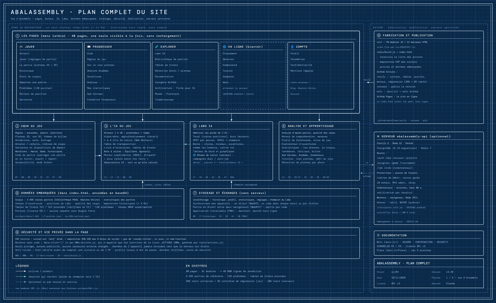
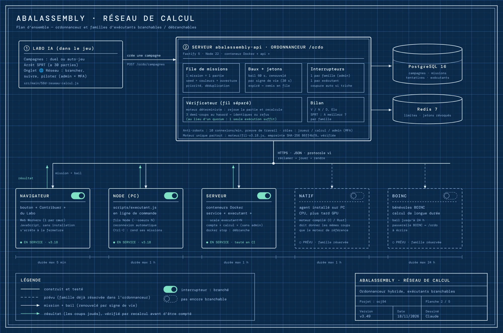
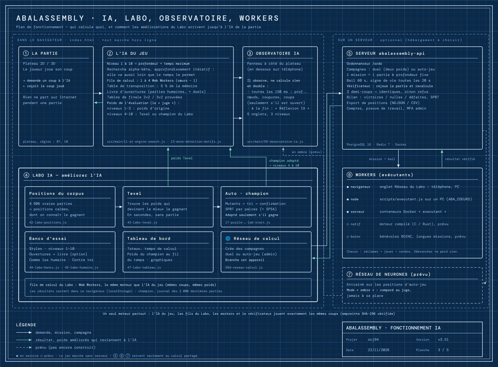

🇬🇧 [English version](../docs-en/Plans.en.md)

# Plans du site

Trois planches dessinées comme des plans d'architecte, de la vue d'ensemble au détail. Elles complètent les schémas de la page [Architecture](Architecture.fr.md) : ceux-là suivent le code pas à pas, ces plans montrent qui fait quoi et comment les parties communiquent.

Les trois planches ont été vérifiées contre le code en v3.49 ; l'inventaire des pages, en bas, est vérifié par un test à chaque poussée. Elles sont **dessinées à la main** : à mettre à jour quand l'architecture change (voir « Modifier un plan » en bas).

---

## 1. Vue d'ensemble

Tout le site sur une planche. À gauche, ce qui tourne dans le navigateur, depuis le seul fichier `index.html`, sans compte et hors ligne : les pages du menu (inventaire plus bas), le cœur du jeu, l'IA, le Labo, l'analyse, les données embarquées, le stockage local et les protections de la page. À droite, ce qui l'entoure : la fabrication (`tools/build.js`, GitHub Actions, GitHub Pages), le serveur optionnel et la documentation.



## 2. Le réseau de calcul

Comment le Labo fait jouer des campagnes de parties par d'autres appareils : l'ordonnanceur `/ordo` du serveur distribue les missions, chaque famille d'exécutants (navigateur, Node, serveur Docker ; natif et BOINC prévus) se branche et se débranche, et chaque partie rendue est vérifiée par recalcul avant d'être comptée. Détails : [Calcul distribué](Calcul-distribue.fr.md).



## 3. Le fonctionnement de l'IA

Qui calcule quoi pendant une partie, et comment les améliorations du Labo reviennent jusqu'à l'IA : les poids Texel et le champion adopté remplacent ceux des niveaux 4 à 10 ; l'Observatoire IA regarde la recherche sans rien recalculer ; le serveur et ses workers ne servent qu'au calcul partagé ; le réseau de neurones prévu sera comparé au « juge » en mode ombre, jamais mis à sa place. Détails : [Observatoire IA](Observatoire-IA.fr.md), [Réflexion de l'IA](Reflexion-IA.fr.md).



---

---

## Inventaire des pages

Toutes les pages du site, par leur identifiant dans `index.html`. **Cette liste est vérifiée par un test** (`v3.49` dans `tests/engine.test.js`) : une page ajoutée au site sans sa ligne ici, ou une ligne ici sans sa page, et la vérification échoue. C'est ce qui empêche ce document de prendre du retard — ce qui lui est arrivé trois fois.

| Identifiant | Page | À quoi elle sert |
|---|---|---|
| `page-home` | Accueil | Le point d'entrée : jouer, le défi du jour, les sept leçons. |
| `page-setup` | Jouer | Le choix de la partie : disposition, adversaire, niveau, style, pendule. |
| `page-game` | Le plateau | La partie elle-même, avec l'Observatoire IA et l'analyse en direct. |
| `page-campagne` | Campagne | Vingt-quatre adversaires nommés en quatre chapitres (v3.41). |
| `page-lecons` | Sept leçons | Sept écrans de deux minutes pour qui n'a jamais joué (v3.46). |
| `page-learn` | Règles du jeu | Les règles complètes, en référence. |
| `page-academy` | Abalone Academy | Les leçons longues et la stratégie. |
| `page-openings` | Ouvertures | L'arbre des ouvertures tiré des vraies parties. |
| `page-plateau` | Sur un vrai plateau | Le carnet pour jouer sur son plateau en bois. |
| `page-formateurs` | Formation Formateurs | De quoi animer une séance avec un groupe. |
| `page-aide` | Aide | Ce que fait chaque écran du site. |
| `page-puzzles` | Problèmes | Les positions à résoudre, tirées de vraies parties. |
| `page-tablebase` | Tables de finale | L'entraîneur de finales, adossé à la table 4 contre 2. |
| `page-gym` | Gym Cerveau | Les exercices de lecture de position. |
| `page-editor` | Éditeur | Composer une position et la donner au moteur. |
| `page-analysis` | Analyse | Relire une partie coup par coup, avec la carte des positions. |
| `page-stats` | Mes statistiques | Tes parties, dont ce que l'IA en a pensé (v3.38). |
| `page-calendrier` | Calendrier | Jours en colonnes, heures en lignes : parties, Labo, défis (v3.44). |
| `page-corpusstats` | Statistiques du jeu | Le corpus humain : 4 233 parties, et les cartes des données. |
| `page-historique` | Historique | Tes parties archivées, filtrables et rejouables. |
| `page-biblio` | Documentation | Les documents du projet, dont ceux du wiki. |
| `page-camera` | Détection photo / plateau | Lire un vrai plateau par la caméra : photo, direct, réalité augmentée. |
| `page-lab` | Labo IA | L'entraînement du moteur contre lui-même, par paires et par SPRT. |
| `page-lab-host` | Exécutant du Labo | La page qui prête cet appareil au calcul distribué. |
| `page-archi` | Architecture | Les quatre cartes : l'IA, les données, les échanges, les tables. |
| `page-github` | Insights GitHub | L'activité du dépôt, lue depuis les données publiées. |
| `page-variants` | Variantes | Les 189 dispositions de départ, avec leur histoire. |
| `page-museum` | Musée | Les éditions du jeu et les objets. |
| `page-pioneers` | Pionniers | Celles et ceux qui ont fait l'Abalone. |
| `page-trombi` | Trombinoscope | Les visages du jeu. |
| `page-leaderboard` | Classement | Le classement, en attente du serveur. |
| `page-observe` | Observer | Regarder une partie en cours. |
| `page-community` | Communauté | Les clubs, les fédérations, les liens. |
| `page-tournament` | Tournoi | Les tournois du site. |
| `page-compare` | Comparer | Mettre deux joueurs ou deux moteurs côte à côte. |
| `page-friends` | Amis | Les amis, en attente du serveur. |
| `page-profile` | Profil | Ton profil, tes badges (vingt depuis la v3.45) et ta progression. |
| `page-settings` | Paramètres | Les réglages, dont la voix des coups (v3.42) et l'accessibilité. |
| `page-mentions` | Mentions légales | L'éditeur, l'hébergeur, la licence. |
| `page-privacy` | Vie privée | Ce que le site garde : tout chez toi, rien ailleurs. |

---

## Modifier un plan

Les sources sont dans `tools/plans/` : une page HTML avec un dessin SVG par planche et par langue (`vue-ensemble.fr.html`, `vue-ensemble.en.html`…). Corriger les deux langues, puis redessiner les images :

```
npm i -D playwright          # une fois ; seul ce script s'en sert
node tools/plans/rendu.js    # écrit docs-img/plan-*.fr.webp et plan-*.en.webp
```
