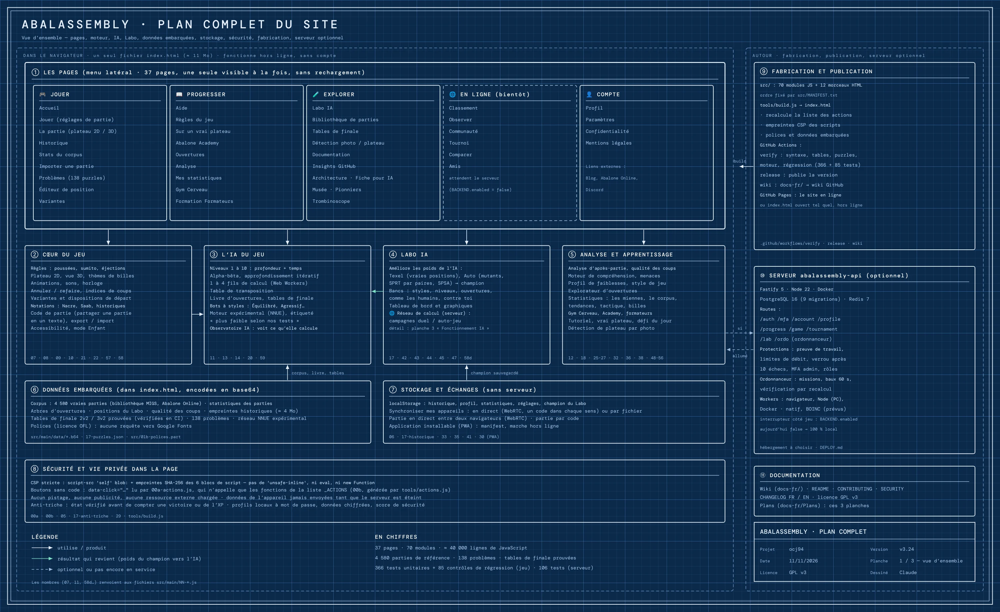
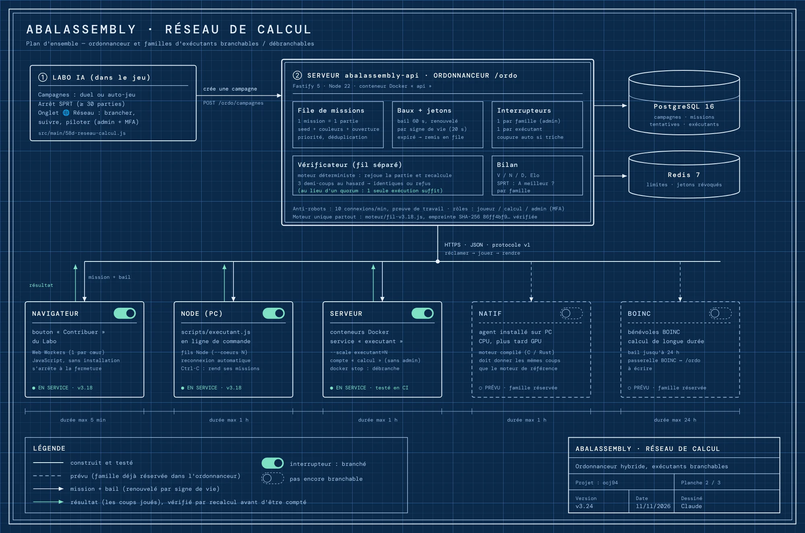
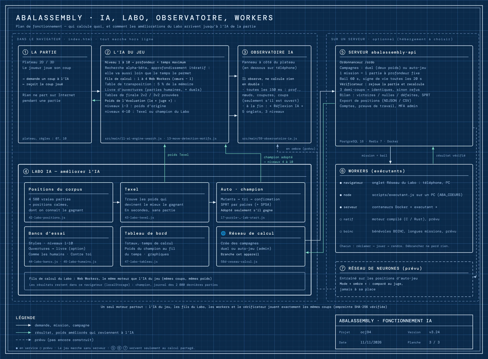

🇬🇧 [English version](../docs-en/Plans.en.md)

# Plans du site

Trois planches dessinées comme des plans d'architecte, de la vue d'ensemble au détail. Elles complètent les schémas de la page [Architecture](Architecture.fr.md) : ceux-là suivent le code pas à pas, ces plans montrent qui fait quoi et comment les parties communiquent.

Vérifiées contre le code en v3.24. Elles sont **dessinées à la main** : à mettre à jour quand l'architecture change (voir « Modifier un plan » en bas).

---

## 1. Vue d'ensemble

Tout le site sur une planche. À gauche, ce qui tourne dans le navigateur, depuis le seul fichier `index.html`, sans compte et hors ligne : les 37 pages du menu, le cœur du jeu, l'IA, le Labo, l'analyse, les données embarquées, le stockage local et les protections de la page. À droite, ce qui l'entoure : la fabrication (`tools/build.js`, GitHub Actions, GitHub Pages), le serveur optionnel et la documentation.



## 2. Le réseau de calcul

Comment le Labo fait jouer des campagnes de parties par d'autres appareils : l'ordonnanceur `/ordo` du serveur distribue les missions, chaque famille d'exécutants (navigateur, Node, serveur Docker ; natif et BOINC prévus) se branche et se débranche, et chaque partie rendue est vérifiée par recalcul avant d'être comptée. Détails : [Calcul distribué](Calcul-distribue.fr.md).



## 3. Le fonctionnement de l'IA

Qui calcule quoi pendant une partie, et comment les améliorations du Labo reviennent jusqu'à l'IA : les poids Texel et le champion adopté remplacent ceux des niveaux 4 à 10 ; l'Observatoire IA regarde la recherche sans rien recalculer ; le serveur et ses workers ne servent qu'au calcul partagé ; le réseau de neurones prévu sera comparé au « juge » en mode ombre, jamais mis à sa place. Détails : [Observatoire IA](Observatoire-IA.fr.md), [Réflexion de l'IA](Reflexion-IA.fr.md).



---

## Modifier un plan

Les sources sont dans `tools/plans/` : une page HTML avec un dessin SVG par planche et par langue (`vue-ensemble.fr.html`, `vue-ensemble.en.html`…). Corriger les deux langues, puis redessiner les images :

```
npm i -D playwright          # une fois ; seul ce script s'en sert
node tools/plans/rendu.js    # écrit docs-img/plan-*.fr.webp et plan-*.en.webp
```
