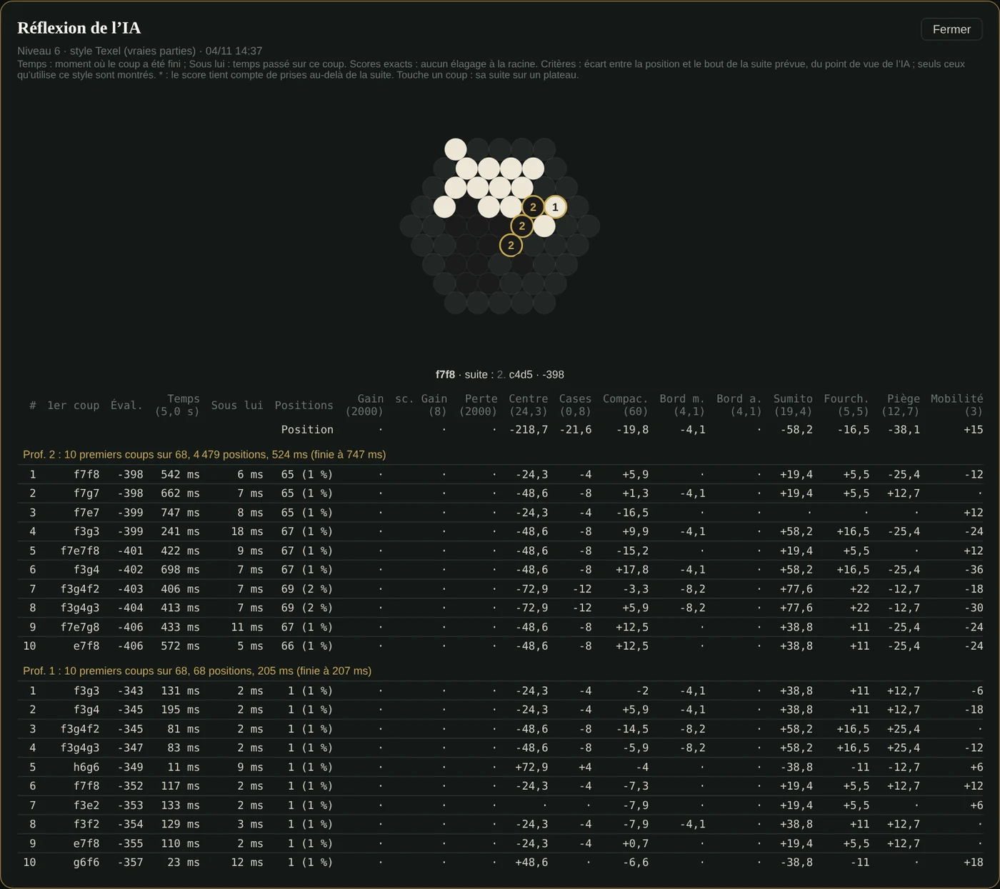

🇬🇧 [English version](../docs-en/Reflexion-IA.en.md)

# Réflexion de l'IA

*Depuis la v2.49.* Après le coup, le tableau qui montre **pourquoi** l'IA a joué son coup, sur le modèle de celui de [KAAH](https://saabalone.github.io/KAAH_Test/) (l'application de Saab), mais calculé par le moteur d'Abalassembly.

*Capture du vrai site : le tableau ouvert depuis un coup de l'IA, la première ligne touchée pour voir sa suite prévue sur le petit plateau (chaque bille déplacée numérotée).*

## Où le voir

- **Dans la partie** : sous la liste des coups, le panneau **« ▸ Réflexion de l'IA »** montre le tableau du dernier coup de l'IA, mis à jour après chacun.
- **Pour n'importe quel coup de l'IA** : touche son évaluation, sous le coup dans la liste (« Mil. +1090 · prof. 8 · 19,0 s › »).
- Le tableau reste en mémoire pendant la partie. L'historique garde l'évaluation compacte de chaque coup (phase, score, profondeur, temps), pas le tableau entier, trop volumineux.

## Ce qu'il contient

Pour **chaque profondeur terminée** (la plus profonde en tête) : « Prof. 4 : 10 premiers coups sur 55, 48 310 positions, 2,1 s (finie à 3,4 s) », puis les **10 meilleurs premiers coups** :

| Colonne | Sens |
|---|---|
| Éval. | score du coup, du point de vue de l'IA (« Gagne » / « Perd » pour un gain ou une perte forcés) |
| Temps | moment où ce coup a été fini, depuis le début de la réflexion |
| Sous lui | temps passé sur ce coup |
| Positions | positions examinées sous ce coup (et leur part de la profondeur) |
| Critères | écart de chaque critère entre la position et le **bout de la suite prévue** |
| Suite prévue | les coups que l'IA attend ; touche la ligne pour la voir sur un petit plateau, chaque bille déplacée numérotée |

Une ligne **Position** donne la valeur des critères au départ. **Seuls les critères qu'utilise le style de la partie** sont montrés : jamais une colonne de zéros qui laisserait croire qu'un critère compte.

## Ce qui garantit les chiffres

- **Scores exacts.** Abalassembly cherche chaque premier coup avec une fenêtre complète : rien n'est élagué à la racine, donc pas de « ≤ » comme chez KAAH.
- **Les critères affichés sont exactement l'évaluation du moteur** : `evalDetail` est une copie exacte de `evaluateBoard`, et leur somme est vérifiée égale sur de vraies positions (tests, section 43-44).
- **Suites vérifiées.** La suite prévue est reconstruite depuis la table de transposition ; sa clé ne contenant pas le camp au trait, chaque coup est contrôlé **légal pour le bon camp**, sinon la suite s'arrête : jamais de suite inventée.
- **Astérisque \*** : le score tient compte d'éjections calculées *au-delà* de la suite affichée (le moteur prolonge tant qu'une prise reste possible). Le tableau le signale au lieu de le cacher.
- Les positions des 10 premiers coups s'additionnent exactement au total de la profondeur.

## Les critères

**Ceux d'Abalassembly** (poids du style équilibré) : Gain et Perte (chaque éjection compte 2 000 : écart de billes + écart de captures), Centre (6), Cohésion (4), Bord m. et Bord a. (8), Mobilité (2), Isolées (18), En danger (14), Chaînes (10), Forteresses (20).

**Ceux de KAAH**, ajoutés au moteur en v2.49 — **éteints par défaut** (ni calculés, ni comptés : l'IA habituelle joue exactement comme avant, vérifié coup pour coup). Réimplémentés d'après leurs **définitions** ; le code de KAAH, sans licence, n'est pas recopié. Poids du profil « Normal » de KAAH :

| Critère | Ce qui est compté (pour soi, contre l'adversaire) | Poids |
|---|---|---:|
| sc. Gain / sc. Perte | la k-ième éjection vaut k−1 fois le poids de plus | 200 / 200 |
| Cases | valeur par type de case : couronne b −5, couronne a −10, coin −12 | ×1 |
| Compac. | distance moyenne entre ses billes, comparée à l'adversaire | 20 |
| Sumito | poussées possibles (2/1, 3/1, 3/2) | 20 |
| Menace | poussées qui éjectent | 120 |
| Fourch. | chaque poussée au-delà de la première | 60 |
| Piège | billes des deux couronnes extérieures sans aucun pas vers le centre (exemple de Saab : a3 entourée de b3, b4, c4) | 40 |

> **Depuis la v2.75**, à partir du niveau 4 en style Auto ou Équilibré, l'IA juge avec des poids réglés sur les vraies parties du corpus (méthode Texel). Ces poids donnent aussi une valeur à certains de ces critères : sur la capture ci-dessus (niveau 6, « style Texel »), on voit Cases, Compac., Sumito, Fourch. et Piège dans le tableau, chacun avec son poids entre parenthèses.

Pour jouer avec : **Configurer avant de jouer → Style → KAAH (expérimental)**. Pour savoir s'ils rendent l'IA plus forte : le test au [Labo](https://github.com/ocj94/Abalassembly/wiki/Labo-IA#test-des-crit%C3%A8res-de-kaah).

Pour voir ce que l'IA calcule **pendant** sa réflexion, coup après coup et en direct, voir [Observatoire IA](Observatoire-IA.fr.md). Pour analyser une partie entière : [Analyser une partie](Analyse.fr.md).
